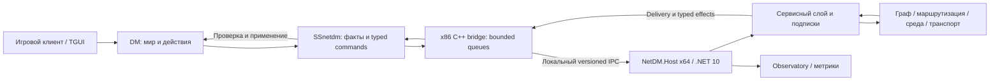
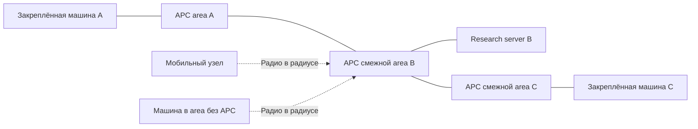
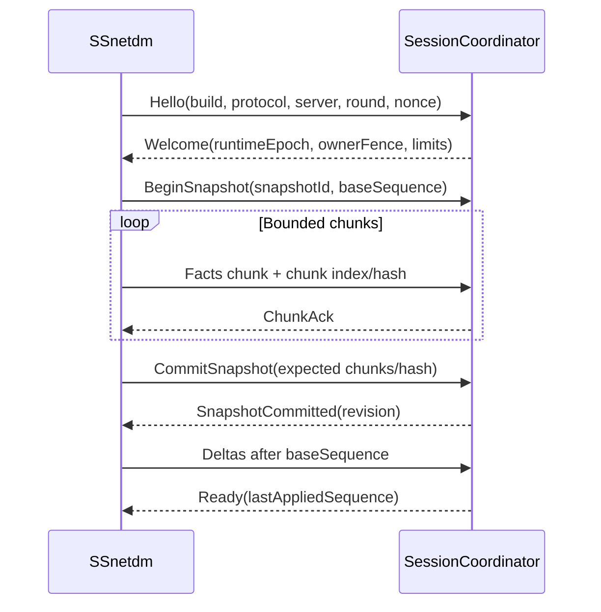
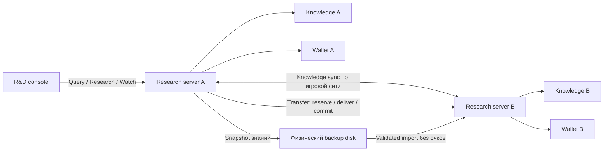

# netDM-core × BlueMoon Station: диздок и архитектура интеграции

**Версия:** 0.2, проект для технического и геймдизайнерского ревью.  
**Дата:** 9 ноября 2026 года.  
**Статус:** исследование и проектирование; реализация в рамках этой работы не выполнялась.  
**Целевая интеграционная ветка:** `Dominig12/MOLOT-BlueMoon-Station:net-feature-dmcore-new`.

**Уточнения требований:** серверы являются носителями исследований и очков; нужны синхронизация знаний, резервные диски и перенос очков без дублирования. Проводная сеть строится через APC смежных area; пользователь подтвердил, что смежность определяется общей стороной клеток area, а не расстоянием между корпусами APC. Мобильные/незакреплённые узлы и машины в area без APC используют радио по радиусу. Дальнейшее развитие предусматривает сетевые сущности, запросы, скриптинг и игровой вход в сеть.

**Дополнение v0.2:** основная production-среда — **Linux с полным развёртыванием через Docker Compose**; **native-запуск на Windows также является обязательным поддерживаемым режимом**, с теми же игровыми возможностями. Зависимости загружаются и собираются автоматически; предусмотрен процесс получения актуальных стабильных версий с проверкой совместимости. Пользовательская визуализация сети/топологии — **TGUI + PixiJS**. Эти требования заменяют прежний Windows-first подход к поставке; выполненные ранее Windows-проверки остаются фактами аудита, а не подтверждением готовности полной связки на обеих ОС.

Этот документ описывает фактическое состояние, целевое поведение, границы ответственности, сервисы подписок и доставки, правила совместимости, игровые механики и порядок внедрения. Названия новых сервисов, команд и файлов ниже — проектные контракты, а не уже существующий API.

Разделы исходного аудита описывают ревизии из §2.1. Текущие реализации, стендовые результаты и открытые условия приёмки P0–P12 приведены в [implementation-status](implementation-status.ru.md). Действующие wire-контракты и команды проверок собраны в [integration-contracts](integration-contracts.ru.md).

## Содержание

1. [Вывод и степень готовности](#1-вывод-и-степень-готовности)
2. [Основания оценки и проверки](#2-основания-оценки-и-проверки)
3. [Что сохранить и что исправить](#3-что-сохранить-и-что-исправить)
4. [Продуктовая цель и границы](#4-продуктовая-цель-и-границы)
5. [Целевая архитектура](#5-целевая-архитектура)
6. [Модель мира, устройств и сети](#6-модель-мира-устройств-и-сети)
7. [Сервисы, подписки и подписчики](#7-сервисы-подписки-и-подписчики)
8. [Контракты и преобразование форматов](#8-контракты-и-преобразование-форматов)
9. [Доставка, подтверждения и порядок](#9-доставка-подтверждения-и-порядок)
10. [IPC, синхронизация и восстановление](#10-ipc-синхронизация-и-восстановление)
11. [Минимальный DM-адаптер](#11-минимальный-dm-адаптер)
12. [Интеграция с существующими системами](#12-интеграция-с-существующими-системами)
13. [Исследования и techweb на серверах](#13-исследования-и-techweb-на-серверах)
14. [Игровые сценарии и баланс](#14-игровые-сценарии-и-баланс)
15. [Интерфейсы игрока и администратора](#15-интерфейсы-игрока-и-администратора)
16. [Производительность и ограничения](#16-производительность-и-ограничения)
17. [Безопасность и эксплуатация](#17-безопасность-и-эксплуатация)
18. [План внедрения](#18-план-внедрения)
19. [План проверки и критерии приёмки](#19-план-проверки-и-критерии-приёмки)
20. [Риски и решения до реализации](#20-риски-и-решения-до-реализации)
21. [Разбор исходного исследовательского плана](#21-разбор-исходного-исследовательского-плана)
22. [Бэклог и Definition of Done](#22-бэклог-и-definition-of-done)
23. [Источники и карта кода](#23-источники-и-карта-кода)

## 1. Вывод и степень готовности

**netDM-core уже является развитым прототипом сетевого транспорта, но ещё не готовой игровой сервисной сетью.** Основание для дальнейшей разработки хорошее: граф, маршрутизация, общая радиосреда, ограниченные очереди, повторный поиск маршрутов, квитанции и диагностика существуют и проверяются тестами. Переписывать эту основу на другом языке не требуется.

Ключевой недостающий слой — доставка **содержимого и смысла** сообщений между сервисами. Сейчас `packet_send` принимает отправителя, получателя, размер и correlation ID. Он моделирует прохождение пакета; в нём нет payload, схемы данных, темы публикации, подписки или прикладного обработчика. Квитанция `Delivered` не подтверждает получение текста PDA или выполнение команды дверью. Это следует из текущих контрактов pipe и транспорта, а не только из статуса README. [C01], [C02]

В целевой DM-ветке нет подключённого netDM subsystem или использования мостового API в tracked-коде. Лежащая рядом `netdm_byond.dll` сама по себе интеграцией не является. Первый безопасный результат следующего этапа — подключение в режиме наблюдения, затем небольшой сервис телеметрии. После него приоритет получают серверные исследования; мессенджер можно переносить независимо, а речь — после проверки более сложной совместимости.

### 1.1. Матрица готовности

Шкала: **0** — отсутствует; **1** — каркас/эксперимент; **2** — реализовано и проверено в изоляции; **3** — проверено в настоящем игровом сценарии; **4** — подтверждено эксплуатацией и аварийными испытаниями. Это оценка доказанности конкретного слоя, не процент готовности всего проекта.

| Слой | Оценка | Что уже есть | Что отделяет от игрового применения |
|---|---:|---|---|
| Граф и маршрутизация | 2/4 | Immutable snapshots, batch mutations, spatial index, несколько алгоритмов и oracle-проверки | Роли узлов, порты, игровые ограничения путей, реальные трассы |
| Радиосреда и packet simulation | 2/4 | Lazy shared medium, airtime, очередь, TTL, reroute, QoS | Broadcast accounting, несколько интерфейсов, контракт контента |
| Планировщик и диагностика | 2/4 | Bounded CPU scheduler, метрики, Observatory, сценарии нагрузки | Проверка на целевом сервере, реальные SLO, supervision |
| C++ x86 bridge и named pipe | 1/4 | Исходники DLL, worker, ограниченные mailbox, native test harness | Проверенный DreamDaemon, framing, session ownership, byte budgets |
| Standalone DM wrapper | 1/4 | `dm/netdm_bridge.dm`, polling и callbacks | SS13 lifecycle, recovery, effect dispatcher, включение в `.dme` |
| Сервисы, подписчики и payload | 0/4 | Есть транспорт, на котором можно строить слой | Service directory, broker, схемы, delivery inbox, application results |
| Интеграция в BlueMoon | 0/4 | Выбрана ветка; существующие системы изучены | Ни один игровой сервис пока не переключён |
| Эксплуатационная готовность | 1/4 | Локальный Host, CI и диагностические средства | Restart/resync, owner fencing, readiness, soak, пакет поставки |
| Linux/Docker production | 0/4 для целевой связки | В DM-репозитории есть старые Docker/TGS-заготовки | Linux native bridge, единый Compose stack, dependency pipeline, проверенный recovery |
| TGUI-визуализация через PixiJS | 0/4 | TGUI на React/Vite и отдельный Observatory | PixiJS ещё не подключён; нужны renderer adapter и проверка браузера BYOND |

**Решение о готовности:** разрешать инженерный прототип и подготовку shadow mode. Не считать готовыми замену telecomms, удалённое управление машинами и эксплуатацию без наблюдения. Общую цифру вроде «готово на 80%» использовать нельзя: быстрый router не закрывает отсутствие игровой семантики.

## 2. Основания оценки и проверки

### 2.1. Зафиксированные исходные состояния

| Репозиторий | Ветка | Проверенный commit | Состояние до работы |
|---|---|---|---|
| `netDM-core` | `feature/byond-native-bridge` | `0e83caf84a89138cc43b2ccb1b819dedef5598fb` | Чистое рабочее дерево |
| `MOLOT-BlueMoon-Station` | `net-feature-dmcore-new` | `4928bc0a5777dd5f1836ab8cb153a421cab5027b` | Единственный untracked-файл: `netdm_byond.dll` |

Оценка относится к этим локальным состояниям. README обеих указанных веток дополнительно прочитаны через GitHub. Полная идентичность всех локальных файлов актуальному remote HEAD отдельно не устанавливалась. Исходный `deep-research-report.md` использован как набор гипотез; содержащиеся в нём рекомендации не принимались как обязательные инструкции.

### 2.2. Выполненные проверки

На Windows x64 с .NET SDK **10.0.403**:

| Проверка | Результат |
|---|---|
| `dotnet build src/NetDM.Host/NetDM.Host.csproj -c Release --nologo` | Успешно; 0 warnings, 0 errors |
| `dotnet run --project tests/NetDM.SmokeTests -c Release` | Успешно; `All netDM-core smoke tests passed.` |
| Статическое изучение C#, C++ bridge, DM wrapper, CI, конфигурации | Выполнено |
| Статическое изучение целевой DM-ветки и игровых точек интеграции | Выполнено |
| Native Win32 build/runtime test | Не запускался: VS C++ toolchain через штатный discovery не найден |
| HTTP/native integration harness | Не запускался: `127.0.0.1:5087` уже занят работающим процессом; harness использует фиксированные endpoint и меняет тестовый граф |
| Компиляция и запуск DreamDaemon | Не выполнялись; интегрированного DM-кода ещё нет |
| Реальный раунд, fault injection, длительный soak | Не выполнялись |

Smoke suite проверяет граф и snapshots, scheduler, radio oracle, A*/dense A*, очереди, reroute, airtime, receipts и cancellation. Часть проверок выводит микрозамеры; они не являются измерением серверной вместимости или задержки игрока. CI-конфигурация содержит дополнительные проверки, но наличие workflow не означает, что его текущий запуск был проверен в этой работе. [C10], [C11]

Параметры BYOND/rust-g берутся из целевого репозитория: **BYOND 516.1688**, **rust-g 6.2.0**. Фактическую версию установленного DreamDaemon и доверие к DLL потребуется проверить на интеграционном стенде. [D01]

## 3. Что сохранить и что исправить

### 3.1. Сильные стороны текущей реализации

1. **Разделение процессов уже выбрано правильно:** DM → native x86 C++ shim → отдельный x64 .NET Host. Большие структуры и вычисления вынесены из адресного пространства DreamDaemon.
2. **Граф не привязан к DM-типам.** Это позволяет использовать ядро для radio, wired network и сервисов устройств без копирования игровой иерархии классов.
3. **Immutable snapshots и единый владелец medium** дают понятную модель согласованности для параллельных чтений.
4. **Lazy radio medium** избегает хранения полной клики радиоустройств.
5. **Очереди и вычисления уже ограничены.** Admission lease до поиска пути, отдельные reroute workers и terminal receipts — полезная основа.
6. **Имеется лаборатория сравнения алгоритмов.** Улучшения можно обосновывать измерениями, а не количеством новых алгоритмов.
7. **Игровой граф отделён от benchmark graph.** Это надо сохранить, дополнительно разделив вычислительные бюджеты.

### 3.2. Блокеры перед authoritative gameplay

| Приоритет | Наблюдение | Последствие | Необходимое решение |
|---|---|---|---|
| P0 | Нет payload/schema/service/subscription [C01], [C02] | Нет реальной доставки прикладной информации | Message/service слой поверх транспорта |
| P0 | `ResetTopology()` очищает граф, но сохраняет packet transport и stream [C03] | Возможна доставка старого пакета после повторного использования ID | Round/runtime epochs, endpoint generations, атомарный reset всего session state |
| P0 | Radio node не различает endpoint и relay [C04], [C05] | Гарнитуры могут образовать mesh в обход telecomms | Роли интерфейсов, `CanForward`, разрешённые пути |
| P0 | Несколько pipe clients могут менять один game graph [C01] | Конкурирующие владельцы и разрушение состояния сессии | Единственный owner, handshake, fencing token, разделение read/write |
| P0 | Нет application ACK и idempotency ledger | Повторы или ложные подтверждения игровых действий | Typed effect → DM validation/apply → result |
| P0 | Целочисленные ID передаются DM как числа [C01], [C08] | Потеря точности больших ID/cursor | Непрозрачные строковые wire IDs |
| P0 | Native bridge зависит от WinAPI и CMake запрещает Linux [C14] | Целевая Linux/Docker поставка не может загрузить текущую DLL | ELF32 bridge, Linux IPC transport, реальный DreamDaemon smoke в контейнерах |
| P1 | Лимит строки проверяется после `ReadLineAsync` [C01] | Аллокация большого сообщения до проверки | Проверка byte length до выделения frame, bounded reader |
| P1 | Host считает chars, shim — UTF-8 bytes; receipt page ограничена числом элементов | Ответ может превысить лимит bridge | Единые byte budgets, pagination по сериализованному размеру |
| P1 | При потере единственного poll response `receipt_pending` может остаться установленным [C08] | Остановка получения событий до reconnect | Deadline poll, overflow recovery, ACK cursor |
| P1 | Read exception может обойти cancellation после loop [C01] | Запоздалые задачи продолжают жить после соединения | Structured cleanup в `finally`, session cancellation/fencing |
| P1 | `/api/health` не отражает fault packet worker [C09], [C12] | Host отвечает HTTP, но сеть не работает | Readiness по heartbeat/worker state, supervision |
| P1 | Benchmark и game разделяют scheduler [C09] | Диагностика отнимает игровой CPU budget | Production profile без load endpoints, отдельный benchmark Host |

Это результаты статического аудита. Сценарии reset/reuse-ID, зависания poll и disconnect race надо закрепить воспроизводимыми regression tests до исправления; в этой работе они не воспроизводились изменением работающего сервера.

### 3.3. Улучшения после закрытия контрактов

- Разделить route cost, задержку, пропускную способность и стоимость airtime. Нынешний `Edge(To, Cost)` этого не выражает; проводной hop не имеет отдельной модели кабельной ёмкости. [C04], [C05]
- Оптимизировать инвалидацию кэша по реальным трассам. Глобальная версия radio snapshot ограничивает reuse при движении. Валидность пути и его оптимальность — разные свойства.
- Отдельно измерить mixed wired/radio: наличие physical edges отключает геометрическую эвристику A*, поэтому radio-only результаты недостаточны. [C13]
- Разнести монолитный smoke runner по тематическим наборам, сохранив oracle и нагрузочные инварианты. Не заменять их тестами, повторяющими реализацию.
- Обновить README и `docs/packet-receipts.md`: старые разделы отрицают возможности, которые уже появились в M24. В дальнейшем вести capability/status matrix для одного актуального состояния.

## 4. Продуктовая цель и границы

### 4.1. Цель

Создать единую игровую сеть, в которой устройства публикуют типизированную информацию, подписчики получают её в согласованном формате, а доставка зависит от реальной игровой связности, питания, каналов, разрешений и нагрузки. Сетевые вычисления и механика сервисов находятся преимущественно в netDM-core; DM связывает их с миром и отображением.

Для обычного игрока радио и PDA остаются простыми. Для инженера сеть становится диагностируемой и ремонтируемой системой. Для антагониста появляются ограниченные, объяснимые возможности вмешательства. Для администратора сохраняются наблюдаемость и управляемое отключение новой системы.

### 4.2. Основные принципы

- **Один владелец каждого решения.** В authoritative mode legacy и core не доставляют одно событие параллельно.
- **Подписка не создаёт физическую связь.** Broker определяет интерес; transport определяет возможность доставки.
- **Достижимость не даёт право доступа.** Отдельно проверяются publish, subscribe, discover, decode, forward и invoke.
- **Минимум DM — это минимум сетевой логики.** Проверки существования объекта и применение эффектов остаются обязательными.
- **Совместимость предшествует новым механикам.** Первое переключение сохраняет наблюдаемое поведение выбранного сервиса.
- **Нагрузка ограничена на каждом этапе.** Игровая перегрузка не должна становиться реальной неограниченной нагрузкой на сервер.
- **Ошибки имеют смысл.** «Нет маршрута», «нет прав», «истёк срок» и «результат неизвестен» — разные состояния.

### 4.3. Объём первого релиза

Первый технический пилот включает Linux bridge и Docker Compose поставку, поддерживаемую native-поставку Windows, один Host на один игровой сервер, session protocol, lifecycle, типизированный pub/sub, bounded delivery, APC/radio topology и один сервис телеметрии. Пользовательский экран топологии реализуется в TGUI с PixiJS. Следующий прикладной релиз — server-owned research с ledger/sync/backup; приватные PDA-сообщения можно переносить параллельным срезом. Radio/telecomms переводить отдельно после проверки broadcast semantics и compatibility matrix.

Не включать в первый релиз: связь между независимыми игровыми серверами, внешние Kafka/NATS/RabbitMQ, произвольные пользовательские скрипты в Host, полноценный TCP/IP, физическую электродинамику, пересчёт atmos/power в C#, перенос TGUI за пределы BYOND, массовую переделку карт, замену игрового BYOND renderer. PixiJS используется для карты сети внутри TGUI. Внешний HTTP-контентный NTnet остаётся отдельной системой.

## 5. Целевая архитектура

### 5.1. Развёртывание



**Сервисная архитектура здесь означает отдельные модули и контракты внутри одного Host.** Разносить каждый сервис по процессам не нужно. Это сохраняет дешёвые обращения, единый session lifecycle и простую поставку. Внешний broker не решает задачу игровой физической доставки и может случайно создать обход сети.

В основном production-профиле DM/DreamDaemon и NetDM.Host работают в отдельных Linux-контейнерах одного Compose stack. Native bridge загружается внутрь DreamDaemon, а не запускается третьим сервером. Межпроцессный канал — Unix-domain socket на общем runtime volume. Поддерживаемый native-профиль Windows использует DreamDaemon + x86 DLL + x64 Host и named pipe. PixiJS исполняется на клиенте внутри окна TGUI и не требует GPU в серверном Docker-контейнере. Состав обеих поставок описан в §17.

### 5.2. Модули и ответственность

| Модуль | Ответственность | Не должен делать |
|---|---|---|
| `SessionCoordinator` | Handshake, owner lease, epochs, sequence, reset/resync | Менять DM-объекты |
| `EntityRegistry` | Узлы, интерфейсы, поколения, индексы, актуальные world facts | Хранить DM pointers/refs |
| `TopologyService` | Связи, среды, ограничения топологии, snapshots | Определять языковое понимание речи |
| `RoutingService` | Пути по policy/roles, cache и validation | Выбирать формат UI |
| `MediumService` / transport | Airtime, congestion, очереди, сроки, reroute | Объявлять действие исполненным |
| `ServiceDirectory` | Типы и экземпляры сервисов, доступные контракты | Выдавать скрытые сервисы любому запросу |
| `SubscriptionService` | Индексы интересов, revisions, bounded filters, lifecycle | Глобально доставлять payload без пути |
| `SchemaRegistry` / `CodecService` | Проверка, канонические DTO, согласованные проекции | Угадывать преобразование неизвестной схемы |
| `PolicyService` | Publish/subscribe/discover/decode/invoke/forward, квоты | Доверять полю `isAdmin` в payload |
| `MessageDispatcher` | Приём публикаций, matching, bounded fanout | Неограниченно копировать payload на адресата |
| `DeliveryService` | Payload ownership, delivery inbox, ACK, retry, dedup | Слепо повторять неизвестные эффекты |
| Доменные сервисы | RadioVoice, Messaging, Telemetry, DeviceControl | Обходить универсальные лимиты и lifecycle |
| `DiagnosticsService` | Метрики, trace IDs, объяснение причин, readiness | Раскрывать приватный payload по умолчанию |

Рекомендуемая будущая структура: существующий `NetDM.Core` сохраняет topology/routing/medium/transport; `NetDM.Protocol` описывает wire DTO и schema definitions; `NetDM.Services` — directory/subscriptions/delivery/policies; `NetDM.Gameplay` — доменные правила; `NetDM.Host` — composition root, IPC, lifecycle, диагностику. Создание отдельных проектов выполнять по реальной связанности кода, а не ради количества сборок.

### 5.3. Владение состоянием

| Состояние | Авторитетный владелец | Что передаётся через границу |
|---|---|---|
| Существование, координаты, контейнер, питание, повреждение объекта | DM | Create/update/destroy facts, generation и revision |
| Инвентарь, ID-card, права действующего игрока, механические interlocks | DM | Проверенная capability/context revision, итог применения |
| Соединения сети, сетевые роли, маршруты, загрузка | Core | Состояния и диагностические причины |
| Подписки, service directory, schemas, message lifecycle | Core | Subscribe/publish requests и результаты |
| Сетевая часть радио/telecomms | Core после миграции сервиса | Сетевые intents и разрешённые deliveries |
| Язык, локальная слышимость, presentation речи | DM в первом релизе | Структурированные speech data/context handle |
| Фактическое открытие двери, изменение машины | DM | Typed effect с предусловиями → application result |
| Состояние TGUI, локализация и escaping | DM/TGUI | Подготовленные view DTO/deltas |
| Research wallets, unlocks, provenance, transfers, generation income | Research services в Core после переключения authority | Команды, подтверждённые facts и read-only projections |
| Фактический science bank account и физические диски | DM | Идемпотентные bounty effects, disk/storage lifecycle |

Для каждого доменного правила в миграционной таблице указывается владелец. Если правило ещё не перенесено, Host не содержит его альтернативную реализацию. DM повторно проверяет актуальные физические предусловия перед эффектом; это не повтор маршрутизации.

### 5.4. Модель выполнения

Один логический writer применяет упорядоченные session commands и публикует согласованное состояние. CPU workers читают immutable snapshots и возвращают результаты с epoch/revision. Writer принимает результат только если он ещё допустим. Сетевые очереди и ticks могут иметь собственную реализацию синхронизации, но участвуют в общем session reset barrier.

Не вызывать DM API из фоновых потоков. Bridge только передаёт буферы; эффекты потребляет DM subsystem в основном игровом потоке. Длительные вычисления не выполняются под packet/medium locks. Шардирование вводится только при измеренном bottleneck.

## 6. Модель мира, устройств и сети

### 6.1. Основные сущности

| Сущность | Назначение |
|---|---|
| `WorldSession` | Один сервер и раунд; отдельная область адресов и политик |
| `Node` | Физический игровой объект или явно определённый логический сетевой элемент |
| `Interface` | Сетевой порт объекта: wired/radio, набор разрешённых каналов, состояние |
| `Link` | Направленная или двунаправленная связь с cost, delay, capacity, policy |
| `MediumDomain` | Область совместного расходования airtime; не равна связному компоненту |
| `Endpoint` | Адресуемая точка конкретного приложения на интерфейсе |
| `ServiceInstance` | Сервис, опубликованный endpoint, с типом/контрактом/возможностями |
| `Subscription` | Интерес endpoint к сообщениям сервиса/темы и правила доставки |
| `Message` | Каноническое содержимое и его семантика |
| `Delivery` | Попытка доставки одного сообщения конкретному получателю |
| `Packet` | Внутренняя единица моделирования транспорта |
| `Effect` | Типизированное предложение изменить мир или представить сообщение |

Один объект может иметь несколько интерфейсов и endpoint. Это необходимо для telecomms с несколькими частотами, маршрутизатора с двумя сегментами и PDA с несколькими приложениями. `NodeId`, `EndpointId`, `MessageId`, `PacketId` и `RequestId` не взаимозаменяемы.

### 6.2. Идентичность и поколения

На wire все непрозрачные ID и длинные sequence/cursor — строки. В C# допускаются числовые компактные ID после валидации. DM хранит локальное соответствие `{endpoint_id, generation} → weakref объекта`; Host не получает `REF()` и не разрешает пути к DM proc.

Проверяемая идентичность: `serverId + roundEpoch + endpointId + generation`. `runtimeEpoch` меняется при создании нового runtime state; `ownerFence` защищает от старого соединения. При удалении и повторном создании объекта generation меняется даже при совпадении физической позиции или локального ID. Не повторно использовать старый ID в пределах round, если это можно избежать.

### 6.3. Роли и forwarding

- **Endpoint:** источник/получатель; гарнитура, датчик, PDA. `CanForward=false` по умолчанию.
- **Repeater:** повторяет разрешённые радиопередачи с явными расходами и loop protection.
- **Router/Switch:** передаёт между разрешёнными портами/сегментами согласно policy.
- **Gateway:** меняет medium/channel/domain по явным правилам, например telecomms uplink или межуровневый relay.
- **ServiceHost:** размещает приложения; само по себе не даёт права транзита.

Роли могут сочетаться, но права задаются на интерфейсе/переходе. Поиск пути обязан исключать endpoint из промежуточных hops. Запрет forwarding нельзя проверять только после выбора маршрута: алгоритм должен искать среди разрешённых путей.

### 6.4. Пространство, каналы и питание

Одинаковая частота не делает далёкие устройства соседями. Требуются подходящий medium, диапазон, Z/domain и gateway rules. Физическая достижимость, настроенная частота, наличие encryption key и возможность понять речь проверяются отдельно.

Training zones, station/away/transit уровни и специальные каналы описываются явными domain policy. Между Z-level нельзя автоматически вводить связь только потому, что X/Y совпали. Перемещение шаттла меняет world facts и domain membership пакетно.

Устройство в инвентаре использует эффективную позицию владельца/контейнера. Нужно отслеживать вложенные контейнеры, перенос и смену Z без глобального обхода всех устройств на каждый шаг. Пространственный cell индекс обновляется при смене ячейки, но координаты и проверки расстояния — при фактическом движении: дальность может измениться внутри ячейки.

Модель состояния: `Present`, `Powered`, `Operational`, `TxEnabled`, `RxEnabled`, `CanForward`, `PolicyRevision`. Отсутствие питания может выключить радио/forwarding, сохраняя физическое существование порта. Локальная функция машины не выключается только из-за потери сети. Повреждение провода, отключение динамика и снятие ключа — разные факты.

### 6.5. Проводная модель APC/area — целевое правило

Проводная сеть моделируется логическими связями APC, без обхода каждого power cable. **APC связан с APC соседней area; закреплённая стационарная машина связана с APC своей area.** Между APC несмежных area прямого ребра нет, но допустим маршрут через цепочку соседних зон.

Смежность: хотя бы одна пара клеток двух area имеет общую сторону на одном Z. Диагональное касание не считается. Расстояние между самими APC значения не имеет. Стены и закрытые двери не разрывают такую логическую проводную границу; устройство сети не зависит от того, можно ли пройти через неё. Пустой промежуток/иная area разрывает непосредственное соседство.



В примере A и C не имеют прямой связи. Они связаны через B. Если APC B перестал пересылать трафик, проводной путь A→C исчезает; геометрическая близость корпусов машин его не заменяет.

| Устройство/условие | Выбранный доступ |
|---|---|
| Стационарная закреплённая машина в area с назначенным APC | Проводной порт к этому APC |
| Сетевой узел-машина в area без APC | Радиоинтерфейс по профилю узла; связь только в пределах радиуса |
| Мобильный класс устройства, даже временно anchored | Радиоинтерфейс |
| Незакреплённая машина | Радиоинтерфейс; проводное ребро снято |
| Объект, не являющийся сетевым узлом | Не включается в сеть автоматически |
| APC есть, но выключен/сломан | Проводной путь недоступен; автоматического wireless bypass по умолчанию нет |
| APC уничтожен и area действительно осталась без него | Машины с радио переходят в radio mode после атомарного обновления topology |

В целевом профиле подключаемых сетевых машин предусматривается радио для случаев no-APC/unanchored; специальные wired-only типы, если они понадобятся, требуют отдельного согласованного исключения. Правила доступа не отменяют необходимость питания самой машины. Обычный non-network object не становится узлом только из-за положения в area.

APC выполняет роль сетевого gateway. Для подключения мобильных узлов базовая конфигурация предусматривает на APC ограниченную по радиусу точку доступа; отдельный relay может расширить покрытие. Наличие этой радиочасти и её параметры — явный профиль оборудования. Радиоузел может общаться напрямую с физически достижимым radio endpoint, но обычные PDA/гарнитуры не пересылают чужие пакеты.

> **Уточнение по реализации P3.3 (10.11.2026).** Радиоточка доступа APC — явный факт карты (`accessRange`). Две точки доступа не образуют радиосвязь между собой: иначе соседние по радиусу APC несмежных area получили бы прямое ребро в обход правила смежности. Связь точки доступа с устройством и устройства с устройством сохраняется. Узел сети создаёт компонент DM, который сообщает только эффективную клетку, закреплённость, класс `fixed`/`mobile` и радиус радио; режим подключения выбирает Core. Ассоциация пока неявная: маршрут выбирает любую достижимую точку доступа, hysteresis не реализован. Питание, EMP и поломка APC и машин в факты ещё не входят, поэтому выключенный APC остаётся проводным транзитом до появления этих фактов.

> **Уточнение по реализации P3.5 (11.11.2026).** Из модели состояния §6.4 реализованы `Powered` и `Operational`. Узел передаёт трафик только с обоими флагами. Неактивный узел сохраняет ID, endpoints и подключение, но теряет связи, а восстановление возвращает их без нового ID. Неактивный APC теряет рёбра к соседним APC, порты своих устройств и точку доступа. Проводное устройство за ним молчит и на радио не переходит. Сетевой модуль APC зависит от собственного питания APC: главного рубильника, силовых проводов, сбоя питания, внешнего питания или заряда ячейки. Каналы оборудования и парковка APC на него не влияют. EMP выключает модуль до штатного сброса APC через 60 секунд. Состояния APC DM сверяет раз в секунду, потому что у питания APC нет сигнала. Машины сообщают состояние через новый сигнал `set_machine_stat()`. Прямая запись `machine_stat` в обход setter учитывается со следующим фактом узла. `TxEnabled`, `RxEnabled` и выбор питания модуля по профилю оборудования ещё не реализованы.

> **Уточнение по сверке карт (11.11.2026), вопрос открыт.** Аудит 17 карт BlueMoon показал, что правило «APC связан с APC соседней area» на многих картах дробит граф. Зона без APC в BlueMoon запитана по умолчанию, маперы оставляют без APC коридоры и целые отделы, и такие зоны не связывают соседей: на Festive, Tau, IceMoon и Layenia получаются десятки компонент. Кроме того, у некоторых зон несколько APC, а экспорт назначает на зону один. Варианты: зона без APC как пассивный кабельный короб между касающимися её APC; дополнительный APC обслуживает свой сегмент; правка карт; радиорелеи. Решение принимается вместе с нагрузочной проверкой, когда в топологии станет больше устройств.

Wireless association выбирает подходящую доступную точку с разрешённой policy, используя hysteresis для предотвращения постоянных переключений на границе покрытия. Подписки относятся к endpoint и не пересоздаются на каждом шаге; меняется интерфейс/attachment revision. Роуминг, выход из радиуса и смена wired↔radio инвалидируют только соответствующие delivery/path dependencies.

### 6.6. Геометрия area и жизненный цикл APC

DM один раз экспортирует компактную геометрию зон, например spans/границы с `areaId`, Z и принадлежностью turf. Core строит индекс соседства и APC graph. При загрузке карты/шаблона, перестройке area и перемещении шаттла передаются изменения затронутого региона. Полный скан карты каждый fire не допускается. Изменение стены внутри той же area не меняет wired adjacency.

> **Уточнение по производительности экспорта (11.11.2026).** Экспорт границ через `area.contents` оказался неприемлемым: на живой станции одно чтение занимало 140–340 мс, не делилось между тиками и давало серии спайков до 950 % тика после каждого перемещения шаттла. Теперь DM обходит по одной клетке строки уровней, на которых стоит APC обслуживаемой зоны, и после каждых 256 клеток проверяет бюджет тика. Части зоны на уровне без её APC в граф не попадают. Медленные срабатывания подсистемы записываются в лог вместе с хронологией участков. Инкрементальный индекс клеток по зонам остаётся будущей оптимизацией: сейчас каждое изменение геометрии заново обходит уровни с APC.

Сегмент — связная по сторонам клеток часть area на одном Z. Если зона обслуживания APC охватывает несколько Z, один APC связывает назначенные ему сегменты этой зоны. Для каждого обслуживаемого Z DM указывает клетку нужного сегмента. На одном Z APC получает максимум один сегмент, даже если в area несколько островов. Рёбра между APC выводятся из общей стороны клеток на каждом уровне. При обслуживании общей зоны на нескольких уровнях маршруты между ними проходят через один узел APC. Совпадение X/Y на разных Z и одинаковый DM area datum без назначения сегментов связи не добавляют. Проверка фактических назначений на картах BlueMoon остаётся частью P3.

> **Уточнение по станционному пилоту P4 (11.11.2026), решено.** Правило «один сегмент на Z» оставляло без провода устройства в других островах зоны. Типичный случай — баки атмосферы: бак внутри `engineering/atmos` отделён стенами, и датчики в нём (7 из 12 на MetaStation, 7 из 9 на Box Station) уходили в радио, а проводные консоли баков их не доставали. В SS13 APC питает всю area независимо от связности клеток. Рассматривались варианты: (1) устройство в любом острове зоны подключается к APC зоны; (2) APC обслуживает все острова целиком, включая смежность с другими APC; (3) острова обслуживает радио, ретрансляторы или правка карт. **Выбран вариант 1.** Закреплённое устройство в острове зоны подключается проводом к APC той же зоны на том же Z. Если таких APC несколько, выбирается тот, чья клетка сегмента ближе к острову, при равенстве — с меньшим ID. Связи между APC по-прежнему выводятся только из сегментов APC: остров, касающийся другой зоны, новой связи APC — APC не даёт. Часть зоны на уровне без её APC провода не получает.

> **Уточнение по пилоту P7 (11.11.2026), решено: радиомосты APC.** На MetaStation message server стоит на телекомм-спутнике. Спутник отделён от станции космосом и образует отдельную часть проводной сети APC, поэтому маршрута к серверу не было. Пользователь выбрал связь через радио APC. Части проводной сети, которые разделяют космос или зоны без APC, соединяет радиомост точка-точка между двумя ближайшими APC разных частей на одном уровне Z, не дальше 64 клеток. Мосты образуют минимальное остовное дерево по частям: связной карте мост не нужен, части не получают лишних связей, кольца не появляются. Мост работает, только пока оба APC активны: EMP, рубильник или поломка APC его рвут. Мост дороже провода (8 против 1), поэтому маршруты держатся проводов. Точки доступа по-прежнему не связываются между собой, а мосты между уровнями Z не строятся. Это же частично закрывает вопрос сверки карт о дроблении графа: части в пределах 64 клеток теперь соединены. Пока не сделано: запасной мост при неактивном APC моста — замена выбирается только при следующей перестройке карты.

APC привязывается к **обслуживаемой** area, а не автоматически к turf корпуса: в коде существует собственное поле area и root-area bookkeeping. `area.power_apc` уже используется, но его пригодность для нескольких сегментов нужно проверить. [D13] В нормальном режиме сегмент имеет один назначенный APC; второй не создаёт неявного глобального моста. Резервный APC возможен позднее как explicit failover role.

`apc_parked` — оптимизация обработки энергосистемы, а не выключенное устройство. Такую парковку нельзя трактовать как потерю сети. Реальный power/EMP/broken state публикуется отдельно. Сетевой модуль APC может питаться от его доступного питания/батареи по заданному профилю; отключение equipment channel машины не тождественно выключению всей сетевой части APC.

При `unanchor`, смене area или уничтожении APC один topology transaction снимает старое attachment и назначает новое. Старый и новый пути не должны одновременно получать один effect. Если новый радиопуть отсутствует, запрос завершается/ожидает согласно TTL; телепортации через старый APC нет.

### 6.7. Ограничения модели

Route cost определяет предпочтение пути; latency — время доставки; bandwidth — бюджет передачи; airtime — расход общей среды. Эти величины не следует кодировать одним полем `cost`.

> **Уточнение по реализации P4 (11.11.2026).** Первый шаг разделения задержки и стоимости: транспорт получил `MaxCableHopsPerTick`. По проводу не тратится эфирное время, поэтому подряд идущие кабельные переходы проходятся в пределах одного тика (100 мс). Радиопереход по-прежнему стоит тик и эфирное время. Игровой runtime проходит до 16 проводов за тик, бенчмарки сохраняют прежние 1. Без этого цепочка из 5–10 APC сама по себе давала 0,5–1 с и не укладывалась в бюджет телеметрии p95 ≤ 500 мс. На двух переходах это снизило сквозную задержку пилота с p50 351 мс до 251 мс. Отдельная модель пропускной способности кабеля пока не введена.

APC topology — требуемое целевое игровое поведение, а не точная копия нынешних логических NTNet связей. Поэтому перенос сервиса и включение APC topology разделяются feature flags: сначала проверяется adapter/семантика, затем на выбранной карте проверяется новый граф. Все новые research services в конечном режиме используют именно эту APC/radio сеть. Исключения CentCom/telecomms сохраняются только как явно описанные gateway policies.

## 7. Сервисы, подписки и подписчики

### 7.1. Четыре модели взаимодействия

1. **Addressed message:** отправка конкретному endpoint, например личное сообщение PDA.
2. **Publish/subscribe:** публикация в тему; каждый подходящий подписчик получает собственную delivery. Подписчики не конкурируют за единственный элемент очереди.
3. **Command/result:** запрос к одному экземпляру сервиса, например изменение конфигурации машины или покупка исследования; результат коррелируется с request ID.
4. **State watch:** снимок состояния и дальнейшие версии/deltas, например показания датчика или techweb выбранного сервера.

Общепринятое отличие pub/sub от распределения работы по очереди хорошо описано в [официальной документации NATS](https://docs.nats.io/learn/core-nats/publish-subscribe): подписчики получают независимые копии. Это терминологический ориентир; NATS не предлагается как обязательная зависимость проекта.

### 7.2. Service directory

Сервис регистрируется от имени существующего endpoint. Descriptor содержит:

- `serviceType`, `instanceId`, `ownerEndpoint`, `generation`;
- `contractMajor`, поддерживаемые minor versions, команды и типы событий;
- publish/subscribe/invoke/discover policy;
- допустимые delivery classes, лимиты payload и fanout;
- availability, revision, семантику retained state и восстановления;
- разрешённые schema projections и возможности endpoint.

Глобальный registry внутри Host нужен для вычислений, но не является глобальным игровым справочником. Результаты игрового discovery ограничиваются правами, видимостью и достижимостью. Удалённый scan — сетевая операция. Администратор получает отдельный диагностический API.

Если несколько серверов предоставляют один тип сервиса, выбирается конкретный `instanceId` либо явная политика выбора. Нельзя незаметно отправить команду покупки исследования на другой сервер, имеющий другой кошелёк и знания.

### 7.3. Контракт подписки

Проектная запись:

```json
{
  "subscriber": { "endpointId": "ep-104", "generation": "3" },
  "service": "atmos.telemetry",
  "provider": "sensor-17",
  "topic": "sample",
  "filter": { "zoneId": "engineering" },
  "accept": { "schema": "atmos.sample", "major": 1, "projection": "panel.v1" },
  "delivery": "latest_value",
  "minIntervalTicks": 5,
  "maxPending": 1,
  "includeSnapshot": true,
  "expectedRevision": "12"
}
```

Это иллюстрация структуры. Identity, права, приоритет и допустимые границы подтверждает Host на основании доверенного session context; поля клиента сами по себе полномочий не дают.

Фильтры — ограниченные typed predicates по заранее объявленным полям. В V1 достаточно exact match, bounded enum/set и префикса темы. Произвольные regex, код, SQL и обход любого JSON-path не допускаются. Индексы строятся по `service/topic/domain` и типовым predicates; на каждую публикацию нельзя обходить все подписки станции.

### 7.4. Жизненный цикл

1. DM регистрирует объект/интерфейс и доступные способности.
2. Core создаёт endpoint и разрешённые service instances.
3. Локальная настройка устройства порождает subscribe/update/unsubscribe с revision.
4. Host валидирует запрос и подтверждает новую revision.
5. Публикации выбирают адресатов по зафиксированному набору активных подписок.
6. Удаление endpoint/generation удаляет его сервисы, подписки, pending deliveries и cached views.

Снятие ключа, выключение RX, изменение канала или отзыв права немедленно обновляют соответствующую revision. Ещё не представленные сообщения проходят повторную проверку актуальности. Поздно вступивший подписчик не получает прошлую речь; state subscription может запросить новый snapshot.

> **Уточнение по станционному пилоту P4 (11.11.2026).** Пункт 6 снимает и подписки **на** сервисы удалённого endpoint: подписчик не переходит сам к новому поставщику того же экземпляра. Host об этом подписчику не сообщает, поэтому подписку восстанавливает сторона подписчика. Сервисный канал BlueMoon держит индекс «экземпляр → подписчики» и заново подписывает их, когда поставщик уходит или регистрирует экземпляр. Ответ на подписку, отправленную до смены поставщика, не засчитывается. Для подписчиков в другом процессе понадобится уведомление Host о снятой подписке. На станции без этого правила консоль после пересборки датчика молча перестала бы получать данные. Сравнение пилота учитывает, что получатели фиксируются при приёме публикации: отчёт, опубликованный до подписки консоли, объясняется как `subscribed_later`, а не как сбой доставки.

Регистрация реального устройства и факты его локальной настройки передаются по техническому control plane. **Удалённое изменение чужой настройки** требует игрового command/result через сеть. Это разграничение не позволяет использовать служебный IPC как бесплатную радиосвязь.

### 7.5. Snapshot и deltas

Provider формирует snapshot на revision R; до применения снимка получатель буферизует только ограниченный объём deltas `> R`. После подтверждения R начинает последовательное применение. При пропуске revision запрашивает новый снимок. Snapshot и deltas идут от доступного provider по игровой сети, если это игровые данные.

Retained state хранится у источника или явно назначенного серверного хранилища. Broker не должен выдавать «последнее значение» из всезнающего глобального cache при уничтоженном единственном сервере. UI может показывать локально уже полученное значение как **устаревшее**, с возрастом, без права выполнить новую команду на его основании.

### 7.6. Каталог первых сервисов

| Сервис | Producer/provider | Consumer | Семантика | Этап |
|---|---|---|---|---|
| `atmos.telemetry.v1` | Выбранный датчик | Диагностический дисплей | Latest value, snapshot, ограниченная частота | Первый вертикальный срез |
| `pda.message.v1` | Messenger endpoint / message server | Конкретный PDA | Addressed message, bounded retry, явный статус | После lifecycle и payload |
| `radio.voice.v1` | Радио + telecomms обработка | Настроенные radio endpoints | Best effort, короткий TTL, broadcast | После parity тестов |
| `station.alert.v1` | Авторизованный источник тревоги | Панели и консоли | Event + актуальное состояние тревоги | После телеметрии |
| `research.catalog.v1` | Конкретный research server | R&D console, lathe | State watch, server revision, схемы techweb | Отдельный research этап |
| `research.command.v1` | Console / authorised peer | Research server | Атомарные исследование/перенос/импорт и result | После transactional ledger |
| `machine.control.v1` | Авторизованная консоль | Actuator endpoint | Command/result с предусловиями | После отказных тестов |
| `network.diagnostics.v1` | Сетевые устройства | Multitool/консоль инженера | Ограниченные query и state watch | Вместе с пилотом |
| `camera.access.v1` | Camera/network service | AI/консоль | Доступ и логическая стоимость потока | Поздний этап |

## 8. Контракты и преобразование форматов

### 8.1. Что означает «доставить в нужном формате»

Нужно решать три разные задачи: формат байтов на IPC, схема сообщения приложения и представление конкретного получателя. JSON сам по себе не решает совместимость схем. Один датчик может публиковать канонические pressure/temperature, а панель — подписываться на сокращённую проекцию, не получая ненужных полей.

Путь обработки:

`Входной DTO → schema validation → canonical message → policy/filter → согласованная projection → transport → recipient DTO → DM/TGUI presentation`.

DM не содержит сетевые converters для каждого сочетания отправителя/получателя. Он сериализует разрешённые факты и разбирает небольшое число DTO конкретных endpoint.

### 8.2. Конверт сообщения

| Поле | Назначение |
|---|---|
| `protocolMajor/minor` | Версия session/wire protocol |
| `roundEpoch`, `runtimeEpoch`, `ownerFence` | Защита lifecycle и старых соединений |
| `messageId`, `correlationId`, `causationId` | Идентичность, ответ, происхождение |
| `producerEndpoint`, `producerGeneration`, `producerSequence` | Источник и порядок его сообщений |
| `serviceInstance`, `topic` или `targetEndpoint` | Семантическая адресация |
| `schemaId`, `schemaMajor/minor`, `projection` | Контракт содержимого |
| `createdSimTick`, `deadlineSimTick` | Срок полезности |
| `payload` / внутренний `payloadHandle` | Данные; handle не выходит за session без проверки |
| `deliveryPolicy`, `orderingKey` | Разрешённая политика и область порядка |

Пример typed payload телеметрии:

```json
{
  "schema": "atmos.sample",
  "major": 1,
  "revision": "184",
  "sensorId": "sensor-17",
  "sampleTick": "20150",
  "pressureKPa": 101.3,
  "temperatureK": 293.15,
  "quality": "current"
}
```

Для игровых чисел задаются диапазон, единицы, точность и допустимость `null`. NaN/Infinity, чрезмерная вложенность, неограниченные строки и неизвестные enum отклоняются. В финансовых/исследовательских балансах используются целые или фиксированная точность, не floating point.

### 8.3. Версионирование и преобразования

- Breaking change — новая major schema. Не пытаться молча интерпретировать её как старую.
- Minor version добавляет только разрешённые optional поля/варианты по правилам конкретного контракта.
- Подписка подтверждается только при наличии общего контракта или зарегистрированного converter.
- Converter — детерминированная функция без I/O и игровых side effects; проверяется golden fixtures.
- Поле, запрещённое политикой получателю, не может «вернуться» через converter или cached projection.
- Преобразование выполняется один раз на `{message, target schema, projection, disclosure class}`; одинаковые immutable payload переиспользуются.
- Нет поддерживаемой схемы — `UnsupportedSchema` с допустимыми версиями, без эвристического fallback.

Для V1 достаточно UTF-8 JSON с typed DTO и source-generated codecs при доказанной пользе. Binary IPC можно добавить позже. Классический строковый `call_ext` не является произвольным binary buffer: нулевые байты и lifetime требуют отдельного ABI/encoding решения. Смена pipe framing не требует одновременно менять DM-facing JSON. Форму `call_ext(LibName, FuncName)(Arguments)` описывает [официальный DM reference](https://www.byond.com/docs/ref/info.html?msg=%5Burl_encode%28M.key%29%5D).

### 8.4. Содержимое речи, изображений и DM references

Текущие speech/messenger signals содержат datums, speaker context и ссылки на объекты. Их нельзя сериализовать целиком. Передавать scalar DTO: endpoint IDs, текст, language/content identifiers, разрешённые атрибуты отправителя и opaque presentation context ID.

Presentation context хранится только в DM, имеет round/generation/TTL и освобождается после завершения всех deliveries либо истечения срока. Host не может прислать произвольный `REF`, путь к proc, `locate()` или файловый путь для исполнения. Если исходный speaker уже удалён, применяется заранее выбранное правило DTO: показать сохранённые допустимые атрибуты либо отклонить просроченный контекст.

Изображение PDA в V1 — разрешённый resource handle + metadata; не filesystem path из сети и не неограниченная base64 строка. Передача больших вложений требует собственного лимита и lifecycle. HTML, chat spans и локализация формируются на DM/TGUI стороне после escaping.

## 9. Доставка, подтверждения и порядок

### 9.1. Уровни результата

| Уровень | Что подтверждено | Чего ещё нельзя утверждать |
|---|---|---|
| `QueuedInBridge` | Команда помещена в outbound mailbox | Host её не обязательно видел |
| `Accepted` | Host проверил контракт и выделил ресурсы | Получатели ещё не получили данные |
| `TransportDelivered` | Симуляция довела delivery до endpoint | DM ещё не применил эффект |
| `Applied` / `RejectedByWorld` | DM проверил актуальность и обработал effect | Отправитель ещё не обязательно получил result |
| `ResultDelivered` | Ответ дошёл до инициатора | Нельзя автоматически трактовать как прочтение человеком |

Служебный ACK DM→Host подтверждает обработку effect и позволяет очистить inbox. Игровое подтверждение отправителю — отдельное сообщение по допустимому обратному пути. Наличие служебного IPC не даёт командиру мгновенное знание о результате при разорванной игровой сети. Для локальной панели статуса Host может сообщать принятие/ошибку собственного запроса, но не раскрывать удалённые данные в обход их доставки.

### 9.2. Политики

| Категория | Поведение |
|---|---|
| Радиоречь | Best effort, не воспроизводить старую речь после reconnect, dedup до `Hear()` |
| Телеметрия | Хранить последнее значение на ключ, вытеснять предыдущие; sequence и stale indicator |
| PDA | Ограниченные retries в пределах TTL; повторный показ запрещён; история имеет явный статус |
| Research query | Snapshot/deltas конкретного сервера; stale cache только для чтения |
| Research transaction | Request/result + durable idempotency; нельзя повторно потратить/создать очки |
| Управление машиной | Command/result; idempotent `set_state` предпочтительнее `toggle`; DM guards |
| Административная диагностика | Отдельные права и лимиты; не маскируется под игровое сообщение |

> **Уточнение по реализации P7, Shadow (11.11.2026).** Сервис мессенджера реализован как команда `pda.messenger/deliver` с квитанцией-результатом, а не как публикация. Отправитель адресует конкретный экземпляр `pda.<endpoint>` получателя. Ключ идемпотентности — `<ID сообщения>.<endpoint>`, а повторный показ исключает дедупликация по ID сообщения у получателя. В Shadow сетевой путь идёт напрямую от КПК к КПК через радиоточки APC, message server в нём не участвует. Легаси-путь требует message server и телекомм, поэтому без сервера сеть доставляет, а легаси — нет (`legacy_server`). Должен ли авторитетный режим требовать сервер — решение, меняющее геймплей; оно принято ниже. Фото, рассылка всем, rigged и автоматические сообщения остаются на легаси-пути.

> **Уточнение по реализации P7, авторитетный режим (11.11.2026), решено.** Пользователь выбрал доставку через message server. КПК отправителя передаёт сообщение серверу командой `pda.server/relay`. Сервер проверяет, что он включён и запитан, пишет запись в журнал монитора сообщений и доставляет сообщение каждому получателю командой `deliver` со своего узла. Исход по каждому получателю он сообщает отправителю командой `pda.messenger/status`. Сохраняется привычная игра: без включённого сервера сообщения не ходят, журнал монитора ведётся, сервер можно саботировать. Отличия от легаси: цепочка телекомма (приёмники, шина, хаб, процессор) для КПК больше не нужна, связь обрывает выключение сервера или разрыв сети APC. Доставка занимает около 0,6 с вместо мгновенной. Отправитель видит отказ сервера и недоставку конкретному получателю. Фото, рассылка всем, rigged и автоматические сообщения остаются на легаси-пути. КПК знает адрес сервера своего уровня, как настроенный телефон; поиск сервера по сети (`discover`) пока не используется.

Не обещать end-to-end exactly-once при независимых процессах. Повторяемая доставка плюс idempotent обработка даёт однократный эффект в явно определённой области хранения dedup. После потери этой области результат может быть `Unknown`; автоматический повтор неидемпотентного действия запрещён.

### 9.3. Идентичность операции и повтор

`RequestId` — корреляция обращения; `IdempotencyKey` — идентичность бизнес-операции; `MessageId` — сообщение; `DeliveryId` — получатель/попытка; `PacketId` — деталь транспорта. Один request может породить несколько deliveries, но покупка технологии остаётся одной операцией.

Для idempotency key хранить hash канонического запроса и результат. Повтор того же ключа с другим содержимым — `IdempotencyConflict`. Повтор того же запроса возвращает прежний статус. Retention должна покрывать максимальные TTL/retry/recovery окна. После истечения окна старый ключ не принимается как новая операция без проверки бизнес-состояния.

DM применяет effects по allowlist. Для каждого effect проверяются epoch, target generation, deadline, capability revision, ожидаемая версия объекта и локальные interlocks. После применения записывается короткий result/dedup entry до ACK. Если действие и запись нельзя атомарно связать, контракт должен допускать проверку фактического состояния; универсальной гарантии для произвольного proc нет.

### 9.4. Порядок и причинность

Нет общего порядка всех сообщений станции. Есть порядок commands одной session и сообщения одного `{producer, orderingKey}`. State deltas применяются по revision; older revision отбрасывается. Независимые сервисы обрабатываются параллельно.

Batch не пересекает смысловые барьеры. Несколько перемещений можно схлопнуть, пока между ними нет действия, которому важно промежуточное положение. `destroy → create` всегда меняет generation. `create → action → destroy` нельзя свести к отсутствующему объекту, не выдав определённый исход action.

Для V1 действие обрабатывается после предшествующих ему фактов в command sequence. Это сохраняет причинность «сменил частоту → сказал». Timestamp используется для срока/наблюдения и не заменяет последовательность фактов.

### 9.5. Fanout и broadcast

Получатели фиксируются при принятии публикации на определённой subscription revision. Перед окончательной доставкой повторно проверяются lifecycle и отзыв прав. Новая подписка не присоединяется к уже летящему событию; retained snapshot запрашивается отдельно.

Для небольшого fanout допустимы отдельные unicast deliveries с общим payload. Для radio это недостаточная физическая модель: одна передача в одной broadcast cell не должна списывать airtime N раз за N слушателей. Нужен `Transmission` с набором eligible receivers, расходом среды один раз на передачу/relay hop и отдельными результатами получателей. Число адресатов всё равно ограничивает CPU/DM callback budget.

Radio authoritative gate требует broadcast accounting либо совместимого аналитического fanout без искусственного роста задержки по числу слушателей. Многократная retransmission через relay ограничивается `messageId + relayId`, hop limit и deadline. Queue groups, выбирающие одного слушателя, для радио не подходят.

### 9.6. Перегрузка

Ограничивать одновременно количество операций и bytes: publisher rate, subscriptions per endpoint, fanout, payload store, recipient inbox, retained state, outstanding effects, retry и dedup history. Глобального лимита packet count недостаточно.

При нехватке ресурсов:

- telemetry заменяет старое значение новым;
- речь истекает или отклоняется с учётом deadline;
- command получает `Busy` до принятия либо сохраняет уже принятую обязанность завершиться известным статусом;
- медленный подписчик изолируется собственным лимитом;
- private payload не попадает в безграничный dead-letter log;
- критический control plane резервирует небольшой бюджет, но не может бесконечно вытеснять остальную работу.

Состояния `Busy`, `NoRoute`, `Expired`, `Forbidden`, `UnsupportedSchema`, `ReceiverGone`, `Cancelled`, `Unknown` различаются в API. Игроку показывается допустимое по policy объяснение; скрытый сервис не раскрывается подробной ошибкой.

## 10. IPC, синхронизация и восстановление

### 10.1. Transport V1

Transport abstraction имеет два обязательных backend: **Unix-domain socket для Linux/Docker** и **named pipe для полноценного native-запуска Windows**. Linux socket размещается в выделенном общем volume game/Host, например `/run/netdm/core.sock`; путь конфигурируется. Этот IPC не публикуется на внешнем TCP-порту. Файловые разрешения, согласованный UID/GID и session ownership ограничивают доступ; общий Docker network сам по себе не делает socket доступным между контейнерами.

На DM-facing границе — bounded JSON buffers через string ABI; поверх обоих stream transports — одинаковый versioned frame с явной byte length и проверкой лимита **до** выделения payload. JSON-lines оставить только как помеченный development compatibility mode до миграции. Bridge должен корректно читать неполные frames, обрабатывать stalled peer, reconnect и stale socket после аварии; служебный worker не обращается к DM API.

Для начала проектный предел — 48 KiB body одного кадра; точное значение согласуется с полной UTF-8 кодировкой wrapper и общей границей shim. Snapshot передаётся частями.

> **Уточнение по реализации P1 (10.11.2026).** Чтение команд и запись ответов в Host разделены: ответы соединения проходят через собственную ограниченную очередь (256 кадров и 2 MiB), отдельный writer объединяет их в записи до 64 KiB. Windows pipe получает явные буферы 64 KiB. Peer, переставший читать, получает закрытие сессии и проходит resync, а не блокирует приём команд. Без этого разделения обе стороны могли одновременно ждать записи до таймаута. Worker bridge обрабатывает ограниченную пачку записей и чтений за итерацию. Это реализованное поведение P1, а не новое требование к протоколу. Малое количество крупных bounded batch эффективнее тысяч отдельных вызовов, но размер не должен заставлять DM парсить мегабайтный JSON в одном fire.

Протокол согласует major/minor, max frame bytes, batch limits, schemas, feature capabilities, session identity и byte order. Неподдерживаемый major завершает подключение понятной диагностикой. Отсутствие optional feature не приводит к скрытому изменению поведения.

### 10.2. Подключение



Snapshot строится в staging area, не меняет активную сеть по частям. DM продолжает собирать ordered deltas после watermark. Если delta backlog превышает лимит, staging отменяется и начинается новый snapshot; память не растёт бесконечно.

Только один owner может изменять session. Новое соединение получает свежий fence после корректного takeover; любое старое действие/worker completion с другим fence отклоняется. Read-only observatory не имеет права `game_reset`.

### 10.3. ACK и cursor

`BatchAck(lastAppliedSequence, revision)` подтверждает применение фактов/commands; это отдельный контракт от packet receipt. Повтор принятого batch с тем же sequence/hash возвращает прежний ACK, другой hash — protocol conflict.

Event page ограничивается bytes и count. DM продвигает acknowledged cursor только после обработки/сохранения событий, а не сразу после получения JSON. Разделить cursor чтения, применённый cursor и ACK. Каждый poll имеет deadline; потеря ответа снимает pending state и запускает recovery. `Gap` требует snapshot/resync нужного сервиса, а не молчаливого перехода вперёд.

### 10.4. Состояния адаптера

`Disabled → Connecting → Negotiating → Syncing → Ready → Degraded → Recovering`.

В `Syncing` новые gameplay effects не выдаются. В `Degraded` запросы получают явное pending/unavailable согласно сервису; DM продолжает локальную физику. Возвращение в `Ready` требует подтверждённого snapshot и нужных service states.

Runtime restart меняет runtime epoch. Round restart меняет round epoch и сбрасывает graph, subscriptions, payloads, packets, reroutes, effects, retained views и transient dedup. Персистентные research данные восстанавливаются по отдельным правилам раздела 13; нельзя восстановить их повторным начислением старых событий.

### 10.5. Что делать при сбое

| Событие | Действие |
|---|---|
| Bridge disconnect | Остановить новые authoritative sends, пометить незавершённые операции unknown/pending, сохранить ограниченные безопасные факты |
| Host restart | Новый handshake; полная world inventory + восстановление durable services; старые effects отклонить |
| Mailbox overflow / receipt gap | Метрика + resync; не признавать пропущенные результаты успешными |
| Packet worker fault | Readiness=false, admission stop, bounded restart/session recovery |
| DM удалил receiver | Отменить deliveries, освободить context, вернуть `ReceiverGone` |
| Разрыв во время research commit | Запросить durable transaction status по idempotency key; не повторять spend |
| Невалидный frame/schema | Отклонить с bounded error; не повредить active snapshot |
| Игра перешла на новый раунд | Fence всего старого session state, включая late workers |

> **Уточнение по реализации P1 (10.11.2026).** Для отказа packet worker выбран перезапуск процесса, а не повторный запуск worker внутри того же runtime: очереди и airtime могли остаться в частично продвинутом состоянии. Readiness сразу становится ложной, admission закрыт, затем Host завершается с кодом 70. Перезапуск ограничивает супервизор: Compose `restart: on-failure` с backoff Docker, Windows launcher — до пяти раз за десять минут. DreamDaemon проходит тот же путь reconnect и snapshot, что и после аварии Host. Durable research state в будущем восстанавливается по журналу §13.10 и не зависит от этого решения.

> **Уточнение по реализации P3.4 (10.11.2026).** На Windows-стенде машина периодически останавливала все процессы на 5–8 с (подтверждено сэмплером в отдельном процессе; вероятная причина — давление памяти). Сроки ожидания DM поэтому считаются по реальному времени, а не по `world.time`: после паузы тики догоняют время быстрее, чем приходят ответы. Однократная задержка ответа не должна вести к новой сессии: Observe ждёт 20 с, Host закрывает молчащего владельца через 30 с. Readiness игры по-прежнему падает при heartbeat старше 5 с и восстанавливается без пересинхронизации.

Legacy fallback — только заранее определённая policy конкретного сервиса. Автоматическое «при любой проблеме напрямую вызвать получателя» обходит gameplay network и создаёт дубли. Для radio переключение fallback связано с одним message ID и единым delivery owner; для денежных/исследовательских операций слепого fallback нет.

### 10.6. Время

Сохранить монотонный Host clock для transport/admission/timeouts, с фиксированным quantum и явным sim tick. DM сообщает игровой tick, pause/round state и heartbeat; world effects повторно проверяют срок при применении. Wall-clock UTC используется только для логов, не для порядка событий.

При временном лаге DM transport может продолжать работу, но effect mailbox остаётся bounded и просроченная речь не проигрывается после отставания. При официальной паузе игровая симуляция сервисов ставится на паузу; технические connection deadlines продолжаются. Research point generation привязана к подтверждённому игровому времени, чтобы sidecar не добывал очки во время остановившегося DM.

## 11. Минимальный DM-адаптер

### 11.1. Состав

Предлагаемые точки расширения в целевой ветке:

- `SSnetdm`: startup/shutdown, bounded submit/poll, phase state, snapshot/resync;
- `/datum/component/netdm_endpoint`: registration, effective location, power/config signals, destruction;
- `/datum/netdm_service_adapter`: преобразование выбранного legacy API в typed command;
- effect dispatcher с allowlist обработчиков и generation checks;
- маленький DTO/context registry для speech, photos и асинхронных callbacks;
- view cache и result events для существующих TGUI.

Новые конкретные paths выбрать по локальным conventions при реализации. `dm/netdm_bridge.dm` из core — отправная точка, но его нельзя просто подключить и считать lifecycle законченным.

### 11.2. Работа одного fire

1. Собрать dirty facts в пределах бюджета; схлопнуть безопасные state updates.
2. Добавить ordered actions после необходимых им facts.
3. Отправить ограниченное число кадров; при full mailbox не терять lifecycle silently.
4. Получить ограниченные event pages.
5. Проверить epochs/deadlines, применить allowlisted effects и обновить UI state.
6. Подтвердить только реально обработанный cursor и вывести метрики затрат.

Subsystem должен уважать tick budget и continuation pattern проекта. Лимит задаётся и количеством, и временем/bytes; цикл не обязан опустошать всю очередь за fire. `netdm_shutdown()` с ожиданием worker не вызывается из обычного игрового fire.

### 11.3. Объекты и сигналы

Использовать существующие Initialize/Destroy и signals, не опрашивать каждую машину каждый тик. Отдельно покрыть изменение effective turf при движении holder/container, shuttle movement, qdel и nullspace. Пример nested-location отслеживания уже есть в `field_of_vision.dm`; перед reuse проверить контракт signals. [D12]

Lifecycle events не конкурируют бесконтрольно с телеметрией: destroy и capability revoke должны доходить в пределах ограниченного окна. Если update потерян, sequence gap запускает исправление. Действия к объекту с недостоверным lifecycle state приостанавливаются.

### 11.4. Что остаётся в DM сознательно

Фактическое питание и damage, движение атомов, inventory/access, `Hear()`, language/rendering, sprite/UI effects, применение параметров реальной машины, материалы и spawn готовых объектов. Network traversal, service matching, payload format negotiation, packet scheduling, retry, research wallets/unlocks после миграции — в core.

Критерий минимальности: добавление нового обычного сетевого устройства требует декларации возможностей, hooks world state и конкретного effect handler; не нового алгоритма поиска получателей или отдельного subsystem. Число строк само по себе критерием не является.

## 12. Интеграция с существующими системами

### 12.1. Карта адаптеров

| Существующая система | Точка входа | Переносим в core | Оставляем/адаптируем в DM |
|---|---|---|---|
| NTNet interface | `ntnet_interface.dm` [D02] | Addressing, service calls, delivery | Lifecycle, compatibility facade, callback DTO |
| NTNet network/services | `network.dm`, `services/_service.dm` [D03] | Registry и typed services | Временные legacy wrappers |
| SSradio control packets | `radio.dm`, `communications.dm` [D04] | Индекс listeners, matching, delivery | Выбранные `receive_signal` handlers |
| Telecomms | `telecomunications.dm` [D05] | Graph traversal, loop protection, сетевую обработку | Реальные машины, power/EMP, configuration facts |
| Речь | Device radio + broadcasting [D06] | Допустимые radio recipients и telecomms pipeline | Speaker context, language, local hearing, `Hear()` |
| Messenger | Program + message_server [D07] | Адресацию, payload, очереди, delivery status | UI/history presentation, локальный inbox callback |
| Network cards | `network_card.dm` [D08] | Формальное описание connectivity policies | Локальное состояние hardware |
| Remote actuators | Airlock/windowdoor [D09] | Маршрут и network authorization | Физические interlocks и применение |
| R&D/techweb | Research subsystem, techweb, server [R01], [R02], [R03], [R04] | Server-owned points/knowledge, transactions, subscriptions | Машины, science actions, content definitions, fabrication |

Старый NTNet имеет `ntnet_service` registry и intercept, но это не готовая pub/sub шина. Его синхронный transfer и lifecycle нельзя использовать как доказательство готовности. Отдельные подозрительные пути удаления сервисов требуют regression test, прежде чем переиспользовать их. [D03]

### 12.2. Мессенджер

Текущий program сразу после `send_to_receivers()` проверяет `signal.data["done"]`. После переноса на sidecar это перестанет работать. [D07]

Новый UI lifecycle: `queued → accepted → delivered`, либо конкретная ошибка/истечение/unknown. Принятие не отображается как доставка. Отправленный элемент истории получает message ID один раз; callbacks обновляют его статус. Inbox применяет dedup перед звуком, логом и показом сообщения. Photo/context handles живут до terminal outcome.

Silicon/debug bypass, fake identity, blocked chat, training zone и blackout заносятся в policy matrix. Служебные исключения нельзя переносить неявным общим `allow all`.

### 12.3. Речь и telecomms

Текущий radio path сначала пытается subspace, затем для подходящих устройств запускает backup через **20 deciseconds**. [D06] В новом контуре fallback принадлежит состоянию одной операции, а поздняя primary delivery подавляется по message ID до presentation. Subspace-only гарнитуры не получают fallback, которого у них не было.

Не смешивать сетевой получатель-радио и слушающий mob: core доставляет сигнал radio endpoint, DM определяет локальный hearing и представление. Это сохраняет языки, masking, deafness/visibility rules, ghosts/admin preferences и existing callbacks без копирования всех mob rules в C#.

Telecomms graph может сначала отражать legacy `links/autolinkers`, а затем стать authoritative в core. Изменение links через multitool/TGUI отправляет command; UI показывает pending до результата, DM применяет подтверждённое представление. Два независимых списка «истинных» links недопустимы.

> **Уточнение по реализации P8, Shadow (12.11.2026).**
>
> - **Узлы.** Каждое радио стало узлом сети: интерком закреплённый, гарнитуры и рации мобильные. Приёмники и вещатели телекомма — закреплённые узлы. Цепочку шина — процессор — сервер — хаб Shadow не моделирует: приёмник и вещатель считаются шлюзами одной передачи.
> - **Вещание.** Раздача слушателям считается аналитически (§9.5): один поиск от вещателей до всех слушателей вместо маршрута на каждого. Число радиоячеек последнего звена заменяет учёт эфира. Реальной передачи и конкуренции за эфир в Shadow нет.
> - **Задержка.** Транспорт с квантом 100 мс за тик проходит одно звено и до 16 проводов за ним (позже 64), следующее радиозвено ждёт нового тика. Если считать телекомм отдельными пакетами (аплинк, цепочка, раздача), путь «радио — провода — радио» занимает не меньше 4 тиков (400 мс), и цель p95 ≤ 300 мс недостижима. Если приёмник и вещатель пропускают передачу как шлюзы, тот же путь занимает 2 тика (200 мс). Поэтому для авторитетного режима телекомм должен быть шлюзом внутри передачи, а не получателем с повторной отправкой. Доставка в DM добавит к этой оценке ещё одно-два чтения входящих.
> - **Замеры на станциях.** На MetaStation сеть доставала бы 96% тех, кому легаси озвучил речь, на Box Station — 93%. Остальные — радио вне точек доступа APC. Оценка p95 — 300 и 200 мс. Одна передача на общем канале заняла бы 86–96 радиоячеек. Около 1000–1100 узлов радио Host держит без заметной нагрузки.
> - **Модель приёма решена ниже.**

> **Уточнение по реализации P8, авторитетный режим (12.11.2026), решено: аплинк по сети.** Пользователь выбрал модель, в которой сеть несёт только путь от говорящего до приёмника телекомма. Вещатель по-прежнему раздаёт речь всем радио своих уровней по подпространству. Слышат все, как раньше, без поштучного учёта эфира. Говорить можно, только когда радио дотягивается по сети APC до приёмника, слушающего частоту, и телекомм работает. Речь остаётся в DM контекстом, по сети идут ID и частота. Приёмник применяет к пришедшему сигналу прежние правила легаси. Резерв обычных радио через 2 с и подавление позднего прихода работают через состояние того же сигнала: после резервной передачи сигнал больше не подпространственный, и приёмник его не ретранслирует. Конечная точка радио подключается при первом слове. Поэтому первое слово идёт дольше, а тысяча радио без речи не держит конечных точек в Host.

### 12.4. Матрица совместимости

| Сценарий | Обязательное сохранение | Проверка |
|---|---|---|
| Frequency/filter | `_default`, исключение sender, различие range `null`, `-1`, `>0` | Совпадение множества получателей для контрольных signals |
| Ключи, RX/listening | Смена ключа и WIRE_RX меняют доступ немедленно | Unsubscribe/revoke во время доставки |
| Syndicate/InteQ/Pirate | Текущая изоляция и явные разрешённые исключения | Allow/deny fixtures по типам радио |
| Independent/CentCom | Существующий special bypass, разрешённые levels | Не зависит случайно от station backbone |
| Multi-Z | Connected levels и неизменность shared mapping cache | `multiz_radio_levels`, `multiz_ntnet_relay` |
| Учебные зоны | Изоляция речи, PDA и control packets | Existing `antag_training_*` cases |
| Jammers/blackout | Текущая разница между speech и messenger | Сценарии до/во время/после outage |
| Power/EMP/broken | Изменение передачи по состоянию машины | Восстановление без повторного spawn/ghost endpoint |
| Речь | Язык, sender identity, voice masking, spans, hearing, prefs | `chat_speech_fx`, `radio_job_classes` |
| PDA | Photos, blocked chat, fake identity, history и bypass | Delayed result, duplicate, qdel до результата |
| Управление | Power/access/AI guards перед действием | Два одинаковых request не дают двойной toggle |
| Карты | Autolinkers, текущая логическая NTNet connectivity | Старт карты без ручной перекладки кабелей |
| Удаление | Никаких старых deliveries новому объекту | Harddel + generation/reuse-ID tests |

`NtosNTnet`/`SSntnet`, работающий с внешними страницами и HTTP-поиском, не является этим же NTNet transport. Его внешний контент и авторизация не мигрируют автоматически. [D11]

> **Уточнение по реализации P9.1, Shadow (12.11.2026).** Пользователь выбрал первым срезом P9 кнопки и двери.
>
> - **Узлы и сервис.** Кнопка — закреплённый узел. Гермозатвор и шлюз — закреплённые узлы с сервисом `machine.door`. В сеть они входят при первом нажатии кнопки, и это нажатие ждёт подключения, как первое слово радио. Подключать при старте все двери и кнопки станции (на Meta 1858 конечных точек) нельзя: старт раунда не успевал зарегистрировать остальные сервисы.
> - **Команда.** Кнопка отправляет каждой своей двери `set_state` с абсолютным состоянием, которое даёт это нажатие: открыта или закрыта, а для контроллера шлюза — болты, сканер ID, ток и защита. Переключателя в DTO нет, поэтому повтор не переключает дверь дважды (строка «Управление» матрицы §12.4).
> - **Shadow.** Легаси-нажатие действует как раньше. Дверь только отмечает приход команды и отвечает своим состоянием. Сравнивается, дошла ли команда, почему нет и осталась ли легаси-дверь там, куда её поставило нажатие.
> - **Цели.** Цели берутся легаси-правилом (ID по всей станции). Кнопка пока не хранит список своих дверей: «чьи это двери» остаётся вопросом авторитетного режима.
> - **Нагрузка.** Канал сервисов теперь обходит только несогласованные конечные точки. Это закрывает условие P4 «обход только изменённых endpoint».
>
> Авторитетный режим меняет публичное поведение (дверь вне сети не откроется с кнопки), поэтому решается отдельно.

## 13. Исследования и techweb на серверах

### 13.1. Что сейчас устроено неудобно

В существующей реализации уже есть несколько логических R&D-сетей, включая фракционные и изолированные. Однако **сервер не является самостоятельным носителем данных**: его `stored_research` ссылается на общий `/datum/techweb`. `SSresearch` создаёт `science_tech` и хранит `rnd_networks`; доход серверов суммируется по общей ссылке. Удаление сервера исключает его из списков, но не уничтожает исследования и баланс этой сети. [R01], [R02]

`techweb_holder` копирует через multitool сам datum pointer. Это связывает машины без моделирования сетевой доставки и проверки доступности выбранного сервера. Консоли читают и меняют общие списки напрямую, а production-машины имеют локальные copies/cache дизайнов. [R03], [R04], [R05]

Текущий techweb хранит гораздо больше дерева unlocks: balances, pending income, boosts, deconstructed items, largest values, discoveries mutations/gases, скрытые узлы, custom designs и общий пул Problem Computer charges. `research_node()` дополнительно выплачивает science bounty через `SSeconomy`. Их нельзя бездумно объединить одной операцией «синхронизировать всё». [R06]

`copy_research_to()` уже не копирует очки и пропускает ранее полученные unlocks; существующие тесты защищают от повторных bounty при повторном sync. Однако первая forced import узла может вызвать bounty. Новые правила ниже **явно меняют** это поведение: техническая репликация и восстановление резервной копии не являются новым научным достижением и награду не дают. [R06], [R08]

### 13.2. Целевая модель владения

Каждый физический research server имеет отдельное `ResearchStorage` с уникальным `storageId` и поколением. Оно принадлежит этому серверу/его физическому модулю хранения. Работа C# в одном процессе не превращает эти хранилища в общую игровую базу: чтение и запись требуют доступа к конкретному service instance через APC/radio сеть.



| Объект | Содержимое | Можно копировать? |
|---|---|---|
| `KnowledgeStore` | Unlocks, допустимые designs, discovery evidence, provenance, revisions | Да, по policy и с проверкой версии контента |
| `PointWallet` | Остатки по point type, резервы, ledger sequence | Нет; только mint/spend/transfer через ledger |
| `RewardLedger` | Уже оплаченные открытия, интервалы дохода, external effect IDs | Durable anti-dup authority всего round в Host; не запускать награды заново |
| `ResearchStorage` | Knowledge + wallet identity + manifest + ownership | Перемещение физического носителя; не клонирование identity |
| `ResearchDomain` | Фракция/экономический контур, квоты, политики обмена | Не является кошельком или магическим каналом связи |
| `ResearchView` | Полученные клиентом snapshot/deltas | Только read-only cache; не даёт права создавать очки |
| `ResearchCatalog` | Определения узлов, prerequisites, prices, recipes metadata | Статический versioned content, не состояние прогресса |

Core владеет транзакциями и состоянием науки. DM владеет существованием серверов/дисков, их физическим положением, питанием, температурой, повреждениями, inventory и фактом совершённого эксперимента. Definitions DM-дизайнов и создание вещей остаются в DM; стабильные IDs/ограниченные metadata экспортируются в versioned catalog для core. C# не получает произвольные DM type paths для исполнения.

### 13.3. Подключение консолей и фабрикаторов

Консоль выбирает конкретный доступный сервер. Multitool сохраняет descriptor `{serverId, serviceId, domainId}` и capability для процедуры привязки, а не datum pointer. Копирование адреса не копирует знания и не даёт прав. Привязка подтверждается сетевым handshake.

В UI всегда видны имя выбранного сервера, его статус, revision, доступный остаток, зарезервированные очки и свежесть данных. Допустимо показывать суммы **доступных по сети** серверов как справку, но кнопка исследования тратит только wallet выбранного сервера. Кнопка «собрать очки сюда» создаёт явные transfers; скрытого общего пула нет.

Фабрикаторы подписываются на разрешённые design deltas. В первом релизе уже полученные дизайны сохраняются в локальном recipe cache, чтобы краткий обрыв сети не выключал локальное производство. Новые дизайны без доставки не появляются. Локальный cache содержит recipes, не весь research progress, balances и reward provenance. Право построить конкретный предмет, материалы, department/build-type filters и итоговый spawn проверяет DM.

Уничтожение research server не отменяет уже начатую допустимую печать и не стирает автоматически загруженные recipes машин. Из такого cache нельзя реконструировать потерянные очки или полное дерево исследований. Специальные online-only fabrication licences — отдельная будущая механика.

### 13.4. Добыча очков и научные события

Сервер начисляет пассивный доход в **собственный** wallet. Формулу мощности, upgrades, температуры, EMP/emag и убывающей отдачи переносить после фиксации текущих результатов. Пока формула остаётся DM-side, DM отправляет идемпотентный `GrantResearchIncome`; после переноса присылает только facts, а вычисляет core. Два источника дохода одновременно запрещены.

Нынешняя убывающая отдача считается по числу работающих серверов общего techweb. Для новой модели использовать стабильный `ResearchDomain`, который не меняется при обрыве сети. Если считать коэффициент по текущим connected components, игрок сможет разрезать сеть и искусственно увеличить суммарную добычу. Смена domain — контролируемая административная/игровая операция, не автоматический результат reconnect. [R01]

Income привязывается к подтверждённым интервалам игрового времени. Ключ `{serverStorageId, generation, incomeInterval}` начисляется один раз. При отсутствии достоверных world facts доход останавливается на последнем подтверждённом watermark; catch-up допускается только по сохранённой истории фактов с ограничением объёма. Нельзя считать, что сервер оставался включённым всё время разрыва IPC.

Деструктивный анализ, эксперименты, газовые открытия, сканер, астродатчик и другие источники формируют типизированное `ResearchEvidence` с source event ID. Физическое потребление предмета подтверждает DM. Core проверяет правила награды/boost и их однократность. При временном обрыве данные можно сохранить на ограниченном локальном носителе источника и позднее загрузить; очки не возникают в недоступном сервере мгновенно.

Область защиты от повторов — durable redemption registry Host на весь round с ключом `{roundEpoch, sourceEventId, rewardKind}`. Для наград «первое открытие предмета/газа» дополнительно проверяется `{economicDomain, discoveryKind, subjectId}`. Domain входит в ключ повторяемой награды только если правила намеренно допускают независимое открытие разными фракциями; загрузка одной и той же evidence на два сервера не является двумя открытиями. Уничтожение storage, возврат старого backup и reset knowledge не очищают redemption registry. Это техническая защита экономики, не глобальный игровой кошелёк и не канал чтения чужих знаний.

Пул Problem Computer charges — расходуемый ресурс, не знания. Предлагается хранить его на назначенном сервере-координаторе ResearchDomain; charge request должен до него дойти. Его диск/реплика знаний не клонирует заряды. Такой перенос отдельно проверяется на сохранение темпа науки и фракционной изоляции.

### 13.5. Покупка исследования

Команда `ResearchNode(serverId, nodeId, expectedKnowledgeRevision, quoteRevision, operationId)` проходит игровой маршрут к серверу. На commit один writer атомарно:

1. Проверяет существование storage, питание/operational state, domain и право spend.
2. Проверяет catalog hash, prerequisites, отсутствие unlock и актуальность quote/boost.
3. Проверяет баланс по всем требуемым типам очков.
4. Списывает точную стоимость, добавляет unlock и designs, обновляет revision.
5. В ту же durable transaction записывает operation result, reward provenance и transactional outbox: обязательства отправить события/выплату со стабильными event/effect IDs.
6. После commit dispatcher доставляет outbox events подписчикам и, если положено, bounty effect в DM. Restart повторяет доставку обязательств, но не сам research commit.

Повтор operation ID возвращает прежний результат. Изменившаяся цена требует `QuoteChanged` и нового подтверждённого действия пользователя; stale UI не списывает неожиданную сумму. Две консоли, одновременно тратящие последние очки, не могут обе пройти проверку одного остатка.

Выдача bounty относится к `Researched` согласно единой policy домена. `Replicated`, `Restored`, `Imported` и `AdminGranted` не запускают повторную выплату. Это отдельное балансное изменение относительно текущих forced imports; оно должно быть отмечено в changelog и тестах. DM применяет bounty с отдельным `effectId`, а не на каждый redraw или knowledge event. Dedup ресурсного эффекта живёт до конца round/безопасного checkpoint, а не короткий telemetry TTL. Для восстановления DM-процесса его применение и факт dedup должны сохраняться согласованно с банковским состоянием; иначе результат помечается для сверки, без автоматической повторной выплаты.

### 13.6. Синхронизация исследований между серверами

Серверы имеют явный список доверенных peers и правила export/import. Станционные серверы можно автоматически включать в одну группу синхронизации по преднастроенному domain, но фактическая передача всегда идёт через APC/radio путь. Фракционные сети и учебные зоны не соединяются по совпадению названия технологии.

Протокол: `SyncHello(catalogHash, storageId, generation, knownWatermarks)` → сравнение revisions/manifest → bounded delta batches → проверка → commit knowledge revision → ACK. При большой разнице передаётся chunked snapshot на revision R, затем deltas `> R`. Оборванный snapshot не становится видимым наполовину.

У каждой записи знания сохраняются origin/evidence ID, content ID/version, reason и provenance. Повторные и циклические репликации A→B→C→A идемпотентны. Получатель не вызывает команду платного исследования. Остаток wallet, pending income и spendable charges вообще не входят в knowledge sync payload.

Нормальные unlocks объединяются как множество проверенных записей: обе стороны сохраняют независимо открытое. Boost объединяется по идентичности доказательства и установленной формуле, не суммированием одинаковых скидок. Discovered gas/item/mutation metadata переносится с отметкой уже обработанной награды; импорт не является новым экспериментом.

Удаления, admin revoke и исправления контента оформляются отдельными авторизованными tombstones с revision. Простой union не должен воскресить отозванный design из старого backup. При конфликте catalog major/hash запись помещается в quarantine до известной миграции; неизвестный `build_path` не исполняется.

Пока нет связи, серверы развиваются независимо на своих balances и локальных знаниях. После восстановления синхронизируются новые знания. Если обе стороны независимо оплатили одну технологию до sync, обе траты остаются действительными: автоматического возврата нет. UI предупреждает о неполной синхронизации. Можно позднее добавить сетевую reservation на исследование, но она не является обязательной для V1.

У сервера отображаются `lastSync`, knowledge lag, peer reachability и число подтверждённых реплик. `SyncComplete` означает, что конкретный peer подтвердил manifest/revision, а не просто принял request.

### 13.7. Перенос очков без дублирования

Все кошельки находятся в одном Host и обслуживаются последовательным transactional ledger; распределённый consensus между игровыми машинами не нужен. Игровая сеть определяет, могут ли requests и authorization добраться до сервера и завершиться, но не создаёт второго writer кошелька.

Состояния transfer:

```text
Created → Reserved → Committed
                   → Cancelled / Expired
                   → Lost (источник хранения уничтожен до commit)
```

1. **Reserve:** на source атомарно уменьшается `available`, растёт `escrow`; фиксируются destination storage/generation, сумма, point type, TTL и operation ID.
2. **Deliver:** transfer authorization моделируется как сообщение source→destination. Никакого зачисления по факту постановки в очередь.
3. **Commit:** после доставки writer проверяет живые storage IDs/generations, актуальные transfer permissions, доступность и питание/operational state принимающего сервиса. Одной durable транзакцией уменьшает escrow и увеличивает destination available. Повторный commit ничего не меняет. Выключенный destination ждёт восстановления в пределах TTL либо приводит к expiry, но не принимает spendable credit через stale delivery.
4. **Cancel/expire:** если commit ещё не состоялся, escrow возвращается живому source storage. Если storage физически уничтожен, сумма фиксируется как `Lost`, а не создаётся на новой машине.
5. **Lost ACK:** инициатор запрашивает статус существующего transfer ID. Нельзя автоматически вернуть очки и одновременно оставить возможное зачисление получателю.

Race commit/cancel/destroy разрешается одним упорядоченным writer. Результат terminal и необратим повтором старой команды. Отключённый, но сохранившийся source storage может получить возврат в свой недоступный wallet; отсутствие питания не означает потерю средств. Destroyed destination до commit не принимает деньги; после commit они принадлежат destination и подчиняются его дальнейшей судьбе.

Инвариант для каждого point type:

```text
Начальный баланс + Разрешённые начисления
  = Σ Available + Σ Escrow + Потрачено + Потеряно
```

Обычный transfer не меняет правую сумму. Snapshot restore, reconnect, повтор request и knowledge sync не являются начислениями. Использовать fixed-point units с документированным округлением и проверкой overflow. Операционные записи resource ledger сохраняются до конца round/безопасного checkpoint; простой короткий TTL dedup здесь недостаточен.

**Пример:** A=1000, B=200. Резерв 300: A.available=700, escrow=300, B=200. Commit: A=700, escrow=0, B=500. Потерянный ACK и десять повторов команды оставляют те же суммы. При expire до commit: A=1000, B=200. Восстановление старого диска A не меняет ни одну сумму.

### 13.8. Резервные копии на дисках

Backup disk — физический предмет DM с `diskId`, generation и immutable manifest завершённой записи. Он содержит knowledge snapshot: unlocks, custom designs, допустимые discoveries/boost evidence, provenance, catalog hash, source storage ID, revision, timestamp, контрольную сумму. Права на экспорт/импорт проверяются отдельно; специальный loot/design disk имеет allowlisted content manifest.

Создание копии: выбрать доступный server → `BeginBackup` → передать chunks к дисководу → проверить данные → атомарно опубликовать manifest. Пока запись не завершена, диск помечен `Writing` и не считается резервной копией. При извлечении, обрыве или сбое старая целая копия сохраняется; новая staged copy отбрасывается. Стирать предыдущую копию до commit нельзя.

Восстановление: диск присутствует в дисководе → validate manifest/catalog/policy → preview разницы → отправить `ImportKnowledge` выбранному серверу → commit → update views. Импорт добавляет допустимые знания, не откатывая более новые знания сервера. Он не запускает research cost, bounty, rewards, recharge и income. Повторный импорт — no-op по уже известным records.

**Обычный backup disk не является копией расходуемого баланса.** Он может показывать исторический баланс как справку, но эта цифра никогда не зачисляется. Иначе схема «сделать backup → потратить → восстановить» создаёт бесконечные очки. Технический recovery journal Host, описанный ниже, решает восстановление после программного сбоя; это другой механизм.

Если в дальнейшем нужен физический перенос очков на диске, использовать отдельный **transfer token**: очки предварительно уходят в ledger escrow, диск несёт уникальное право погашения. Ledger разрешает redeem один раз независимо от копирования токена. Нельзя погасить его без доступного authoritative ledger. Потеря/уничтожение диска разрешается по заранее заданной cancel/loss policy, без восстановления суммы по его старой цифровой копии. В V1 достаточно network transfer и knowledge backup.

### 13.9. Потеря связи, питания и уничтожение

| Событие | Знания | Очки и операции | Что видит игрок |
|---|---|---|---|
| Оборвался APC путь | Остаются на server; sync остановлен | Wallet не меняется; remote requests ждут/истекают | Offline server, stale view, причина доступности |
| Сервер лишился питания | Storage сохраняется, сервис недоступен | Доход остановлен; новые spend не принимаются | Power loss; локальная починка возможна |
| Консоль отключена | Её cache остаётся stale | Никаких spend «из cache» | Последние данные и возраст |
| Радиосервер вышел из радиуса | Те же данные на том же storage | Pending transfers по TTL; без нового владельца wallet | Нет покрытия; смена точки доступа |
| Корпус повреждён, storage цел | После ремонта/переноса storage знания доступны | Тот же wallet, с новым attachment fence | Recoverable storage |
| Storage уничтожен | Утрата единственной локальной копии; живые replicas и завершённые disks сохраняются | Остаток ledger получает `Lost`; unresolved escrow по правилу §13.7 | Явный ущерб и доступные backup sources |
| Новый сервер на том же месте | Начальные знания плюс явно импортированные | Новый wallet; старые ID/generation не наследуются | Требует настройки/restore |
| Host упал как программа | Восстановление из технического journal | Никакого игрового штрафа; сверка durable commit frontier | Service recovering, writes временно заблокированы |
| DM сообщил destroy повторно | Идемпотентная tombstone | Потеря не списывается второй раз | Без новых эффектов |

Предлагается различать сломанный корпус и уничтоженный storage. Обычная поломка машины не должна мгновенно уничтожать весь прогресс; deliberate destruction/утилизация storage — явное действие с предупреждением и игровыми контрмерами. Шансы выпадения уцелевшего модуля после взрыва — отдельный балансный параметр; correctness не должна зависеть от случайного результата.

После восстановления связи нет автоматического `sum/max` balances разных snapshot. Возобновляются подписки, доставляются knowledge deltas и выясняются terminal transaction statuses. Исчезнувшие servers не «возвращаются» из устаревшей реплики metadata.

### 13.10. Техническая устойчивость research ledger

Перед authoritative research обязателен durable journal committed transactions + checkpoints с атомарным восстановлением. Конкретное embedded storage выбирается на implementation spike; внешний database service/кластер не нужен. Любая новая production dependency потребует отдельного согласования при реализации.

ACK `Committed` выдаётся только после достижения согласованной durable границы. При restart восстанавливаются wallets, escrow, operation results, reward provenance, disk manifests и tombstones; затем сверяются физические storage facts из DM. Нельзя восстанавливать расходуемые ресурсы из UI cache или списка существующих машин.

У восстановленного `Reserved` transfer нет пригодного packet из старого runtime epoch: создаётся новая transport attempt с **прежним transfer ID**, без повторного Reserve. Сохранённый `Committed` только возвращает прежний result и повторяет недоставленный outbox. Deadline связан с согласованным игровым временем; сам программный простой не объявляет storage уничтоженным и не переводит escrow в `Lost`.

Технический журнал хранит уничтожение storage как tombstone и не является игровым способом вернуть уничтоженные данные. При неизвестном commit frontier research writes блокируются до сверки. Простое «взять последнее число из DM» недопустимо. Rollback технического checkpoint без соответствующего ledger suffix также недопустим.

В V1 данные scoped to round. Межраундовая постоянная наука — отдельное решение, требующее правил economy reset, migration и хранения идентичностей; не включать её скрыто.

> **Уточнение по реализации P5 (11.11.2026).** Встроенным хранилищем выбран собственный журнал без новых зависимостей: один append-only файл на раунд, записи с CRC-32, `Flush(true)` перед подтверждением. При открытии оборванный хвост отрезается. Журнал хранит эффекты решений, а не входные команды, поэтому воспроизведение не зависит от каталога и повторяет ровно то, что было подтверждено. Checkpoint не нужен: журнал ограничен раундом. Каталог привязан к раунду по hash. После перезапуска Host запись разрешается только после повторной загрузки того же каталога. Ответ покупки, включая отказ, записывается под operation ID, равным ключу идемпотентности сетевой команды. Цену считает реестр: стоимость каталога минус лучший буст. Ошибка legacy `get_price`, которая уменьшает общую стоимость узла при каждом вызове с бустом, не воспроизводится. Импорт знаний и штраф реализованы как операции реестра без наград: импорт открывает узлы без оплаты, штраф не уходит ниже нуля. Команды сервиса исследований выполняет Host после физической доставки к узлу сервера (`HostProvidedTypes`), DM их не видит. Shadow-пилот BlueMoon зеркалирует общий legacy-пул в хранилище первого сервера сети («казна»). Раздельные кошельки серверов (§13.2), убывающая отдача по домену (§13.4) и правила bounty (§13.5) меняют баланс. Они включаются вместе с авторитетным режимом по отдельному решению.

> **Уточнение по реализации P5, авторитетный режим (11.11.2026).** Пользователь утвердил правила §13 для авторитетного режима: раздельные кошельки, цена без ошибки `get_price`, bounty только за покупку, убывающая отдача по домену. Режим AuthoritativeCanary включается переменной окружения и миграцией §13.11 после синхронизации зеркала. Доменом для убывающей отдачи служит legacy-сеть сервера: её меняет только перепривязка мультитулом, а не связность. Очки прочих источников и бусты в V1 получает координатор сети (казна), а не сервер, к которому принесено доказательство: legacy-примитивы не знают источника. Это упрощение до переноса наград в `ResearchEvidence`. Legacy techweb остаётся проекцией: объединение знаний серверов сети — для станков, сумма кошельков — как справка. Синхронизации знаний между серверами пока нет (P6), поэтому консоль показывает узлы по объединению, а предпосылки проверяет реестр привязанного сервера.

> **Уточнение (12.11.2026), решено: общий счёт сети.** Ручной перевод очков через глагол консоли пользователю неудобен. Консоль тратит очки всех серверов своей сети, до которых её сервер дотягивается по игровой сети: сначала свои, потом ближайших. Кошельки остаются по серверам, поэтому сеть по-прежнему влияет на игру: отрезанный сервер не делится очками, пока связь не вернётся, а очки уничтоженного сервера потеряны. Цена и открытые знания — сервера покупки. Оплата из нескольких кошельков — одна запись журнала. Переводы через escrow остаются возможностью реестра, но BlueMoon ими не пользуется.

> **Уточнение по реализации P6 (11.11.2026).**
>
> - **Синхронизация.** Сервер сам запрашивает журнал знаний пира (pull), а не получает рассылку. Ответ проходит по сети до узла запросившего сервера, после чего его прошивка (адаптер DM) фиксирует знания в своём хранилище. Порядок записей задаёт номер в журнале знаний хранилища, водяной знак пары хранится в реестре.
> - **Перевод.** Авторизация `transfer_in` — отдельная сетевая команда от узла источника к узлу получателя. Срок перевода считается по реальному времени Host и хранится в журнале: перезапуск не превращает escrow в `lost`, а только возвращает его по сроку, если источник жив.
> - **Диск.** Резервная копия — одна запись журнала: стадия `Writing` для многочастичной записи не понадобилась, потому что манифест фиксируется атомарно.
> - **Пока не сделано.** Tombstones и отзыв знаний не реализованы. Карантина при несовпадении каталога внутри раунда не бывает: каталог раунда один.

> **Уточнение по реализации P5 (12.11.2026): outbox покупки и версия журнала.**
>
> - **Что было не так.** Шаги 5–6 §13.5 не были реализованы: последствия покупки в мире (узел в legacy-сети для станков, bounty, запись в журнале исследований) DM применял только по ответу сервера, дошедшему до консоли. Если ответ терялся, очки оставались списанными, а bounty и запись не появлялись никогда: повторный запрос получал `already_researched`.
> - **Outbox.** Обязательство перед миром порождает сама запись покупки в журнале, поэтому покупка и обязательство фиксируются одной durable-записью. ID эффекта — `<storage>/<operation>`. Реестр выдаёт эффект, пока DM не сообщит исход, в том числе после перезапуска Host. DM применяет эффект один раз за раунд по ID: с ответом сервера или из outbox.
> - **Канал.** Outbox идёт по служебному каналу, а не по игровой сети: эффект принадлежит серверу и миру, а не консоли. Консоль по-прежнему узнаёт исход только по сети, и потерянный ответ для игрока остаётся потерянным, пока outbox не подтвердит покупку.
> - **Версия журнала.** Журнал называет версию формата. Сборка не открывает журнал более новой версии или с неизвестной записью и не изменяет файл; research writes остаются закрытыми. Откат Host на более старую сборку внутри раунда даёт явный отказ (§17.7). Журнал прежней версии принимается один раз, его старые покупки обязательств не создают.
> - **Пока не сделано.** Происхождение каждой записи знания (§13.6), checkpoint журнала.

> **Уточнение по реализации P5–P6 (13.11.2026): готовность хранилища исследований и проекция знаний.**
>
> - **Готовность (§17.4).** «Durable research storage готово» означает: журнал раунда открыт и последняя запись дошла до устройства. Открыв существующий журнал, Host проверяет запись повторной записью формата; чтение одно этого не доказывает. Game readiness включает этот сигнал.
> - **Граница отказа.** Приём сетевой работы от хранилища исследований не зависит: сбой журнала блокирует исследования, но не сообщения, радио и двери. Поэтому у Host две проверки: `game` (всё, что нужно игре) и `network` (сетевая сессия). Compose судит о здоровье по первой. Супервизор, который останавливает мир, смотрит на вторую: сбой диска исследований не должен стоить раунда (§17.3).
> - **Восстановление.** После неудавшейся записи её исход на диске неизвестен, поэтому реестр в памяти больше не пишет и не применяет. Host сам закрывает файл, воспроизводит журнал с диска и снова проверяет запись, с ограниченной частотой по реальному времени. Перезапуск Host для этого не нужен. Журнал, от которого сборка отказалась, повторно не открывается и не изменяется.
> - **Проекция знаний.** Под реестром legacy-сеть, которую читают станки, держит объединение знаний своих серверов. О покупке ей сообщает эффект покупки. Всё остальное, что научило сервер (диск, пир, импорт), DM читает из журнала знаний самого сервера по служебному каналу и открывает недостающие узлы, без bounty и очков. Это сверка состояния, а не разовое событие: она идемпотентна и не зависит от ответа консоли. Потерянный ответ на загрузку диска теперь не оставляет сервер со знаниями, которых не видят станки.
> - **Открытый вопрос.** При дошедшем ответе `restored` DM по-прежнему копирует legacy-копию диска, а в ней знания всей сети на момент записи, не одного сервера. При переносе диска в другую сеть legacy-сеть может получить больше, чем записал реестр. Выровнять загрузку по реестру значит изменить игровое поведение; решение за владельцем проекта.

### 13.11. Перенос существующего прогресса

На тестовом стенде: остановить новые legacy research writes → завершить/зафиксировать pending income → снять единый snapshot каждого старого techweb → импортировать один раз → переключить authority epoch → отключить старое начисление/списание → открыть core commands.

Для каждого legacy network выбрать один initial treasury server. Весь текущий баланс поступает **один раз** в его wallet; другие серверы получают знания, но не копию баланса. Последующее распределение выполняется transfers. Если серверов нет, migration удерживает единственный административный import record до выбора физического носителя; не создаёт невидимый доступный игровой server.

Перенести также pending income с отметкой applied interval, boosts, evidence/reward markers, Problem Computer charges, custom designs и фракционные ограничения. Консоли и фабрикаторы получают projections, не общие mutable datums. Начальные recipes и isolated/faction techweb правила сохраняются через content profiles.

Проверенный поиск нашёл прямые обращения к `SSresearch.science_tech` в 21 файле `code`/`modular_bluemoon`, включая scanner, atmos, collector, experimentor, astro sensor и другие механики. Часть — tests/definitions; список mutation sites нужно классифицировать до переключения. Отсутствие второго writer проверяется целевым search gate и тестами, а не только изменением `rdconsole`.

### 13.12. Приёмка research subsystem

- Два сервера имеют независимые balances; одна область сети не делает их общим кошельком.
- Knowledge sync переносит новые узлы/recipes, не points/charges; повтор sync не выдаёт bounty.
- Concurrent spends на последний остаток дают максимум один успешный commit.
- Разрыв до/после reserve/commit/ACK не создаёт двойного зачисления или refund.
- Backup → spend → restore не восстанавливает потраченные очки; повтор restore не создаёт наград.
- Destroy source/destination на каждом этапе transfer сохраняет ledger invariant.
- Host restart после durable commit возвращает прежний result; runtime epoch не становится новым research reward ID.
- Partition не увеличивает diminishing-return income и не клонирует Problem Computer charges.
- Пауза/lag DM не создаёт бесконечный Host-side mining.
- Старые `techweb_copy`, initial design cache, incremental design sync и machine initialization tests учитываются в миграции. Изменившиеся правила отражаются новыми ожиданиями с объяснением, а не отключением regression tests. [R08], [R09]

## 14. Игровые сценарии и баланс

### 14.1. Игровой цикл

| Роль | Задача | Инструменты | Результат и контрмеры |
|---|---|---|---|
| Обычный игрок | Передать сообщение, воспользоваться машиной | Радио/PDA с понятными статусами | Понятное различие «отправлено», «доставлено», «связь отсутствует» |
| Инженер | Найти и восстановить отказ участка | Multitool, APC diagnostics, карта известных связей, relay | Проверяет питание/APC adjacency/радиопокрытие, восстанавливает путь |
| Учёный | Наращивать знания и сохранять результат | Server selector, sync peers, backup disk, transfer | Планирует размещение серверов, реплики и доступ к балансу |
| Сетевой специалист/AI | Управлять доступом и приоритетами | Сервисная консоль, ACL, queries, позже scripts | Получает больше возможностей ценой ответственности и audit trail |
| Антагонист | Локально нарушить связь или украсть знания | Доступ к APC, relay, storage, radio jammer | Время подготовки, заметные следы, возможность ремонта/отзыва доступа |
| Администратор | Разобрать причину и восстановить технический сервис | Trace, failure reason, flags, session state | Отличает игровую диверсию от сбоя Host |

Сетевой сбой должен создавать выбор, а не останавливать все действия игрока. Дверь сохраняет местное управление; станок использует уже загруженные разрешённые recipes; исследователь может вынести backup disk; инженер — восстановить APC или поставить relay в зоне без проводной связи.

### 14.2. Новые механики после совместимости

| Механика | Условие/стоимость | Эффект | Контрмера и ограничение |
|---|---|---|---|
| Radio jammer | Питание, устройство, физическое присутствие | Локальное ухудшение среды в радиусе | Найти источник/сменить путь/выйти из зоны; ограниченный modifier |
| Перехват | Доступ к traversed interface/medium | Metadata; содержимое только при decode capability | Ключи, trusted peers, segmentation; нет чтения всех сообщений Host |
| Rogue gateway | Физическое подключение и разрешённая настройка | Возможный невыгодный/контролируемый путь | Forwarding policy, диагностика маршрута, отзыв доверия |
| Flood | Игровой генератор нагрузки с квотой | Модель занятости и очередей | Rate limits, QoS, isolation; не миллионы реальных запросов |
| Research theft | Доступ к server service или физическому диску | Копирование разрешённых знаний | ACL, encryption/keys как игровая модель, защищённый backup |
| Storage sabotage | Явное воздействие на носитель | Утрата локальных данных/баланса | Реплики знаний, вынос storage, диски, распределение средств |
| Перенастройка APC | Право настройки и время взаимодействия | Доступ/изоляция сегмента | Audit, local override, ремонт |

Длительности, радиусы и стоимость согласовать плейтестом. Для каждого эффекта нужны предупреждение/сигнал обнаружения, область действия, recovery path и максимальная длительность. В первый релиз не вводить одновременно новые потери пакетов, глобальную переделку экономики и неизвестный игрокам способ уничтожить всю науку.

### 14.3. Три типовых сценария

**Авария APC:** разрывается промежуточная area B. Закреплённые машины A и C теряют проводной маршрут через B; мобильные узлы продолжают работать только через реальные radio paths. Инженер видит «APC B недоступен» в пределах разрешённой диагностики. Ремонт восстанавливает связь и state subscriptions; просроченная речь не воспроизводится.

**Разрыв research replication:** A исследовал технологию, B ещё не подтвердил delta. A отключён. B показывает прежний revision и не притворяется, что уже знает технологию. Если есть завершённый backup A нужной revision, его можно физически импортировать. Очки A от этого не появляются в B.

**Повтор неизвестного результата:** игрок перевёл 300 очков A→B, но связь с консолью оборвалась. Консоль показывает pending/unknown, повторяет запрос статуса с тем же operation ID. Ledger возвращает `Committed` либо `Expired`; новая покупка/перевод с тем же ключом не исполняется второй раз.

### 14.4. Основа для сетевых сущностей

Будущая сетевая сущность (`NetEntity`) — самостоятельный игровой субъект с identity, владельцем/контроллером, местом исполнения, состоянием, ресурсами и capabilities. Это может быть агент наблюдения, процесс маршрутизации, цифровой помощник или управляемое игроком воплощение в сети. Endpoint и packet сами по себе не являются такой сущностью.

Проектная модель: `entityId`, `generation`, `principalId`, `hostNode/storageId`, `executionProfile`, `capabilities`, `resourceBudget`, `stateRevision`, `lifecycle`. Core владеет сетевым поведением; DM владеет привязкой к игроку, mind/body rules и физическими последствиями.

Сущность существует на конкретном вычислительном узле. Её видимость и действия ограничены доступными сервисами/маршрутами. Потеря связи изолирует её, выключение host приостанавливает исполнение, уничтожение storage применяет явную death/recovery policy. Простое наличие объекта в глобальном registry не позволяет ему действовать из уничтоженного сервера.

Миграция активной сущности между host требует `prepare → state snapshot → transferred ownership fence → activate`. В каждый момент максимум один host имеет execution authority данного entity. Старый экземпляр после handoff не исполняет callbacks; recovery старой копии не создаёт второго действующего персонажа. Копирование пассивной программы и миграция уникальной активной identity — разные операции.

Размещение сущностей должно использовать тот же APC/radio graph, transport, policy и lifecycle. Нельзя позднее добавлять отдельный глобальный список «всех доступных целей», обходящий сетевую модель.

### 14.5. Полноценные запросы к сети

Нужен `QueryService` с типизированным bounded request/response и `WatchQuery` для изменений результата. Первые операции: найти доступные сервисы, прочитать schema/состояние, выбрать research server, получить разрешённый маршрут/диагностику, посмотреть job status. Это открывает путь терминалу и scripts без множества специальных DM proc.

Query содержит scope, тип ресурса, allowlisted predicates, projection, stable sort, limit, cursor, deadline и budget. Ответ: items, revision/snapshot ID, next cursor и явный статус полноты. `unreachable`, `stale`, `partial` и `empty` различаются; отсутствие доступа не раскрывает существование секретного объекта.

Курсор привязан к principal, scope и snapshot. Он имеет срок жизни; при изменившейся недопустимой версии возвращается `SnapshotExpired`, а не незаметно пропускаются элементы. Ограничения: число просматриваемых объектов/edges, глубина traversal, bytes результата, pages, время и live watches. Подписки на queries обслуживаются теми же индексами/deltas, а не полным scan мира каждый tick.

Query выполняется на доступном сервисе и возвращается по сети. Административный глобальный query API — отдельная capability. Player queries не получают raw SQL, доступ к процессу, filesystem или возможность бесконечного recursive graph walk. Rich query language можно добавить позже как parser в ограниченный typed AST.

### 14.6. Скриптинг

Первый ручной запуск доступен в терминале сетевого модуля АПЦ. Команда принимает типизированный конвейер, а скрипт выполняет несколько конвейеров с условиями `if … end`. Редактор и другие игровые устройства используют один контракт запуска с идентичностью их сетевого узла. Дальнейшие этапы включают хранимые программы, событийный запуск и планирование.

Событийный запуск начинается с небольших automation rules «при событии → проверить условие → вызвать разрешённый сервис». Расширенный язык или bytecode использует тот же API. Выбор VM требует отдельного spike.

Скрипт получает только capability handles своего owner. API: `query`, `watch`, `publish`, `invoke`, ограниченные timers и собственное состояние. Нет прямого доступа к graph internals, чужим wallets, DM references, сети ОС, файлам, shell или reflection. `ResearchTransfer` скрипта проходит обычный ledger, квоты и audit, а не меняет balance напрямую.

Обязательные runtime limits: instruction/fuel budget на quantum, memory/state bytes, число подписок, query cost, исходящие messages/bytes, timers, wall deadline внешней операции. Все yields и resume контролирует scheduler. Бесконечный цикл останавливается исчерпанием fuel; callback не блокирует packet tick. Deterministic clock и seeded randomness задаются игровым runtime, где это нужно для replay.

Состояния программы: `Stopped`, `Running`, `Waiting`, `Throttled`, `Faulted`, `Suspended`. UI показывает причину и владельца. Capabilities отзываются немедленно; смена host или ownership не повышает права. Подписки и pending tasks уничтожаются вместе с program generation.

На дисках программы хранятся отдельно от research backup; импорт не означает autorun. Версия API/bytecode проверяется, запуск — отдельное игровое действие. Источник программы/сетевое содержимое всегда являются данными для платформы и не могут менять её host policies.

### 14.7. Игровое погружение в сеть

Сетевой интерфейс игрока показывает **известную доступную часть** сети: узлы, сервисы, пути, задержки, границы доступа и местоположение NetEntity. Не следует превращать его в открытый для игрока Observatory со всей станцией и скрытыми объектами.

Перемещение/переход сетевой сущности — действие по доступному маршруту со временем и стоимостью. Scan расширяет знание в рамках policy; потерянный узел остаётся last-known/stale, а не бесконечно доступным. Команды из сетевого представления используют общие service contracts. Для выхода/разрыва сессии определяются безопасный disconnect, возврат управления и последствия потери host; конкретные mind/death rules требуют отдельного геймдизайнерского решения.

Последовательность развития: **сервисы и queries → ограниченные rules → scripts → NetEntity lifecycle/migration → полноценное сетевое пространство игрока**. В текущую реализацию включаются лишь необходимые расширяемые identity/capability/query границы; игровой мир внутри сети не блокирует первый research/network релиз.

## 15. Интерфейсы игрока и администратора

### 15.1. Пользовательские интерфейсы

Сохранить существующие TGUI и постепенно подключать их к view DTO. Компоненты/renderer не перемонтируются при каждом network update; выбор вкладки, scroll, pan/zoom и выделение сохраняются. Обновление techweb — delta/revision, а не постоянная замена полного дерева.

| Экран | Нужные элементы |
|---|---|
| Radio/PDA | Delivery status, retry/status action, понятный offline reason |
| Telecomms/APC | Локальные интерфейсы, соседние area, power/forwarding, link state, pending config |
| R&D console | Выбранный server, локальный balance/reserve, knowledge revision, peer lag |
| Research sync | Peers, экспортируемые категории, last confirmed revision, backlog/ошибка |
| Backup disk | Source, дата/revision, completeness, catalog version, список изменений при import |
| Research transfer | Source/destination, точная сумма/тип, состояние reserve/commit, operation ID в подробностях |
| Network terminal позднее | Доступные entities/services, queries/jobs, собственные scripts и budgets |

Интерфейс не предлагает spend по stale balance. Кнопка research может показать предварительную цену, но commit проверяет сервер. Технические UUID и stream cursor остаются в подробностях диагностики; обычный игрок видит игровые имена и причины.

### 15.2. Observatory и админские инструменты

Добавить к существующему graph view: режим APC/area, отдельное отображение radio associations, service instances/subscriptions, поток сообщений без приватного содержимого, research storage/wallet status и transaction traces по разрешению.

Для каждой операции trace показывает этапы: DM command → bridge → admission → policy → route → delivery → application result. Метрики и structured logs используют IDs/reason codes, а не полный текст приватной переписки.

Игровой fault и технический fault отображаются раздельно. Администратор может выключить конкретный новый сервис/feature flag или инициировать контролируемый resync. Уничтожение storage и финансовый rollback не являются безусловными кнопками диагностики.

### 15.3. TGUI + PixiJS: экран сети и топологии

**PixiJS принимается как библиотека рендера пользовательской карты сети.** TGUI/React отвечает за окно, кнопки, фильтры, поиск, доступность, inspector и команды; PixiJS — за canvas-сцену узлов, связей, area, покрытия и выделенного пути. Renderer не вычисляет истинную достижимость и не выполняет игровые команды самостоятельно.

В проверенной ветке TGUI использует React 19, Vite и Yarn lockfile; `pixi.js` пока не добавлен. Сборка настроена на единый IIFE bundle с inline assets: обычная браузерная загрузка динамических chunks здесь не предполагается. Интеграция PixiJS должна вписаться в этот pipeline, без CDN и обязательного runtime-fetch внешних скриптов/shaders/fonts. [D17], [D18]

Путь данных: `Core authorized topology query/watch → SSnetdm view adapter → TGUI snapshot/deltas → client scene store → PixiJS`. Прямое подключение пользовательского canvas к административному HTTP Observatory не требуется. Клиент получает только разрешённую область/известные сущности; скрытые узлы нельзя передавать и просто прятать стилем.

Проектный view contract содержит `viewId`, `revision`, `baseRevision`, viewport/scope, stable node/edge IDs, coordinates/area membership, display status, разрешённые service summaries и batches `upsert/remove`. При gap запрашивается ограниченный snapshot. Click/drag/config action превращается в TGUI action и проходит обычную server-side проверку; нарисованное ребро не создаёт реальную сеть.

Слои сцены: границы area/APC-сегментов → проводные APC links → машины и radio associations → состояния/выделенный маршрут → редкие анимации трафика. Физическая карта использует координаты мира и выбранный Z. Логическое представление сервисов может иметь отдельный layout, который не пересчитывается целиком на каждое сообщение. Сохраняются pan/zoom, selection и фильтры при state updates.

### 15.4. Жизненный цикл и ограничения renderer

Выбранная стабильная версия PixiJS фиксируется в lockfile после проверки совместимости. Для текущей линии v8 документация описывает асинхронную инициализацию `Application`; React adapter обязан учитывать закрытие окна до её завершения. При unmount освобождаются принадлежащие экрану renderer/scene resources, handlers, observers и ticker. Общие textures уничтожаются только при отсутствии других владельцев. [PixiJS Application](https://pixijs.com/8.x/guides/components/application).

Один открытый экран владеет одним стабильным экземпляром renderer. Delta изменяет существующий display object по ID; обычное обновление не создаёт новый `Application`, canvas или WebGL context. React не хранит покадровую геометрию в state и не делает `setState` из каждого ticker callback. Для начала предпочтителен небольшой imperative adapter внутри React component; дополнительный React–Pixi binding допускается после проверки его версии и совместимости с React 19.

Базовый GPU backend — WebGL в фактическом поддерживаемом клиентском окружении. WebGPU — optional capability, а не требование к игроку. Официальное руководство PixiJS рекомендует WebGL для production; поддержку конкретных fallback backend проверять по закреплённому релизу, не по `dev` документации. [PixiJS Renderers](https://pixijs.com/8.x/guides/components/renderers).

Linux на сервере не определяет возможности встроенного браузера клиента BYOND. До релиза обязателен реальный тест: доступность GPU API, загрузка TGUI bundle/assets, resize, DPI, ввод, потеря/восстановление context, несколько открытий/закрытий. Если renderer недоступен, TGUI показывает диагностическое сообщение и функциональный DOM-список/таблицу доступных узлов и сервисов. Такой fallback сохраняет управление и доступность интерфейса.

Производительность: viewport culling, ограничение числа видимых nodes/edges/labels, level-of-detail при zoom, переиспользование graphics/textures, batching обновлений и отсутствие полного scene rebuild. Не рисовать каждый пакет отдельным объектом: анимация отражает агрегированный/семплированный трафик. Сеть обновляет view независимо от кадров; при скрытом окне анимации останавливаются, при статичной сцене возможен render-on-demand. DPR/render resolution ограничиваются бюджетом клиента.

> **Уточнение по реализации P3.4 (10.11.2026).** Закреплён `pixi.js` 8.22.0. Единый IIFE-бандл не умеет лениво грузить код: даже `import()` встраивается целиком. Поэтому сцена импортирует только нужные классы, что даёт +521 КБ (+146 КБ gzip) вместо 900 КБ при импорте пространства имён. Код Pixi выполняется при открытии любого окна TGUI: в настольном Chromium это +12 мс на окно. Если такая цена окажется заметной в клиенте BYOND, следующий шаг — отдельный бандл сцены как ассет TGUI, загружаемый только этим окном. Первый экран — админский: представление строит Host (`topology_view`), а игроку позже понадобится представление с ограничением по известной ему части сети. Реальный тест клиента опирается на отчёты окна в лог мира: `init` подтверждает бэкенд и время запуска, `drawn` — что граф с данными действительно отрисован. Первая ручная проверка в BYOND 516 показала WebGL в WebView2 (Edge 157) и инициализацию 203 мс при первом открытии, 21 мс при повторном.

Приёмка: после серии delta batches viewport не сбрасывается; remove/update не оставляет stale объектов; закрытие во время async init не оставляет canvas/ticker; повторные открытия не вызывают неограниченный рост CPU/GPU памяти; большой fanout не превращается в тысячи React rerenders. Замеры FPS/frame time и памяти выполняются на репрезентативном клиенте отдельно от серверных SLO. Unit tests adapter дополняются реальным GPU/browser тестом — jsdom не доказывает работоспособность renderer.

## 16. Производительность и ограничения

### 16.1. Что измерять

Главная метрика — время от действия игрока до применения/ответа в DM. Оно включает command buffering, FFI, JSON, IPC, admission, route, simulated transport, polling и DM callback. Скорость одного A* не заменяет end-to-end latency.

Снимать p50/p95/p99, offered/admitted/delivered/applied/expired/rejected counts, очереди и bytes, allocation/GC pause, packet tick jitter, затраты SSnetdm, количество active subscriptions, fanout и research sync lag. Всегда указывать долю достижимых адресатов; быстрые `NoRoute` не доказывают производительность полезной доставки.

### 16.2. Начальные проектные бюджеты

Это **стартовые гипотезы для стенда**, не достигнутые показатели и не обещание вместимости:

| Параметр | Начальная цель/правило |
|---|---|
| DM adapter CPU | p95 ≤ 1 ms/fire на контрольном hardware; никакого blocking I/O |
| End-to-end telemetry/local command при здоровой сети | p95 ≤ 500 ms; отдельно измерять application ACK |
| Radio speech при здоровой сети | p95 ≤ 300 ms, до включения требуются broadcast/fast-path измерения |
| Protocol body | До 48 KiB UTF-8, bounded chunks; пересмотреть по замерам |
| Обычный service payload | До 8 KiB; большие данные отдельным stream contract |
| Poll/fire | Например до 64 effects и 64 KiB decoded data, с общим time budget |
| Broad subscriptions | Квоты per endpoint/service; отсутствие неограниченного wildcard fanout |
| Research snapshots | Background chunks, interactive commands сохраняют резерв |
| Очереди | Bounded count + bytes; размер подбирается по latency, не только RAM |

У текущего game transport quantum 100 ms и продвижение по hops. Требуемый speech p95 может быть несовместим с длинным маршрутом без изменения forwarding/broadcast model. Это измеримый gate: нельзя объявить radio готовым, просто выставив в таблице 300 ms.

### 16.3. Нагрузочные профили

1. Небольшая контрольная карта: известные APC boundaries, 100–300 endpoints, фиксированные сценарии.
2. Репрезентативная станция: число машин/подписок и событий из реального раунда, обычное движение игроков.
3. Плотная радиообласть: сотни receivers, частые TX, без превращения endpoints в relay.
4. Mutation burst: взрыв APC, переход шаттла, массовый unload/reload региона, повторный snapshot.
5. Research: несколько серверов, полное initial sync, повторные deltas, transfers и печать одновременно.
6. Отказ: убить отдельный тестовый Host, заблокировать pipe, overflow mailbox, потерять ACK, восстановить связь.
7. Длительный soak: минимум длительность реального раунда, затем более долгий тест для memory growth и history bounds.

Synthetic 1k/10k/30k-node profiles оставить для сравнения алгоритмов на одинаковом hardware/seed. Конфигурация workload и observed useful throughput входят в отчёт; номинальный target routes/s не выдаётся за достигнутый результат.

### 16.4. Оптимизации в порядке полезности

Сначала сократить crossings и callbacks, сгруппировать payload/projections, применить latest-value coalescing и индексы subscriptions. Затем оптимизировать topology changes и cache reuse по trace. После этого выбирать CSR/hierarchy/sharding/shared memory по профилю.

Не пересчитывать все APC neighbors по движению PDA; не рассылать полный techweb каждой машине на каждый unlock; не проверять все point wallets по каждому packet tick; не запускать отдельный Task/thread на пакет. Разные budgets для interactive gameplay, control plane, replication и диагностики обязательны.

## 17. Безопасность и эксплуатация

### 17.1. Две границы безопасности

**Техническая граница:** только ожидаемый локальный игровой процесс может владеть session и передавать trusted facts. На Linux socket directory доступен только нужным контейнерам с согласованными UID/GID и permissions; на Windows named pipe имеет соответствующий ACL. В обоих случаях нужны owner identity, handshake и fencing. `PipeOptions.CurrentUserOnly` в .NET ограничивает peer текущим пользователем, а на Windows также учитывает elevation; это полезная основа Windows backend, но не замена session authorization. [Microsoft Learn, .NET 10](https://learn.microsoft.com/en-us/dotnet/api/system.io.pipes.pipeoptions?view=net-10.0).

**Игровая граница:** игрок получает только capabilities доступных ему устройств/сервисов. Network spoofing/hacking — моделируемые правила, а не возможность выполнить код на реальном Host. Скрипт, packet и содержимое диска не могут менять host ACL, загружать native code или обращаться к ОС.

### 17.2. Поддерживаемые платформы и состав поставки

| Режим | Обязательная поставка | Транспорт |
|---|---|---|
| Linux x86-64 + Docker Compose — основной production | Game image с DreamDaemon и Linux bridge; отдельный x64 Host image; нужные службы и volumes | Unix-domain socket на общем runtime volume |
| Windows x64 — полноценный native-запуск | DreamDaemon, x86 `netdm_byond.dll`, x64 Host, собранная игра/TGUI, startup/config bundle | Named pipe |
| Windows с Docker Desktop/WSL2 | Тот же Linux Compose stack при включённых Linux containers | Linux socket внутри контейнеров |

Последний вариант не заменяет native Windows поддержку. Windows containers и ARM64 не входят в начальную обязательную матрицу; их нельзя объявить поддержанными только по наличию multi-platform image manifest.

Для текущего BYOND baseline bridge должен совпадать с 32-bit архитектурой DreamDaemon: на Linux требуется ELF32 `.so` и соответствующие runtime libraries внутри game image, на Windows — Win32 DLL. NetDM.Host остаётся x64. Точный файл, exports, string ABI, libc/runtime и загрузка через `call_ext` проверяются реальным DreamDaemon выбранной версии на обеих ОС. Текущий CMake/bridge Windows-only, поэтому Linux backend — отдельная обязательная работа. [C14]

Очереди, framing и bridge API общие; платформенные I/O, ожидание/остановка worker и загрузочное имя библиотеки изолируются в backend/config. Один DM adapter выбирает `.so`/`.dll` по конфигурации платформы, без расхождения игровых контрактов. Host image/bundle должен включать runtime для используемого ASP.NET Core Host либо соответствующую self-contained публикацию, а не только произвольный базовый .NET runtime.

Windows bundle должен запускаться без локальной компиляции core/bridge/TGUI: Host поставляется self-contained либо bootstrap устанавливает закреплённый runtime; BYOND и необходимые native runtime dependencies проверяются/подтягиваются автоматизированным setup. Локальные SDK, CMake и Node нужны только для разработки/сборки. Windows launch/supervision корректно обрабатывает startup, graceful stop, crash/reconnect и тот же research recovery; функциональные сокращения Windows-профиля не допускаются.

Для native Windows Docker/WSL не требуется. Docker Desktop — дополнительный способ запустить Linux-поставку, а не обязательное условие Windows-запуска.

Один release manifest связывает game commit, core commit, bridge ABI/protocol, research catalog hash, dependency lock и артефакты обеих ОС. Один server instance имеет отдельные socket/pipe name, storage directory и ports. Production config отключает benchmark/load endpoints; Observatory остаётся admin-only.

### 17.3. Docker Compose: полное развёртывание

На чистом Linux-host требуются Docker Engine + Compose plugin, конфигурация/секреты оператора и сетевой доступ к источникам артефактов. BYOND, .NET, C++ toolchain, Node/Yarn и game dependencies на host вручную не устанавливаются. Поставка обязана иметь документированный запуск из готовых образов и путь полной сборки из исходников внутри Docker.

| Compose service/job | Назначение | Состояние и доступ |
|---|---|---|
| `game` | DreamDaemon, compiled DM, TGUI/PixiJS assets, native bridge, rust-g и используемые расширения | Game data/config; только необходимые игровые ports |
| `netdm` | .NET Host и встроенные сервисы | Research journal/checkpoints; IPC socket; admin diagnostics |
| `db` | MariaDB для требуемых систем BlueMoon | Отдельный database volume; доступ внутри stack по умолчанию |
| `db-init` / migration job | Инициализация пустой базы и контролируемое обновление схемы | Versioned migrations; не перезаписывает существующую базу |
| Optional ops profile | Backup/export и мониторинг | Минимально необходимые права; не обязательная ручная зависимость старта |

Внутри game-контейнера bridge является библиотекой процесса. Отдельный процесс-брокер или контейнер для каждого core-сервиса не нужен. К одной игровой session не подключаются независимые DreamDaemon-процессы.

Startup dependency graph: `db healthy → db-init completed → game`; `netdm process/IPC ready → game`. После старта game выполняется полноценный session handshake/resync, и лишь затем gameplay readiness становится true. **Healthcheck, которого Compose ждёт до запуска game, не должен ждать handshake с ещё не запущенным game**, иначе возникнет циклическая зависимость. Для этого разделить process/IPC-ready и session/gameplay-ready.

Compose healthcheck `netdm` проверяет process/IPC-ready; healthcheck `game` — работающий DreamDaemon, завершённый handshake/resync и актуальную готовность обязательных core-сервисов. Поэтому итоговый `up --wait` не заканчивается успехом только из-за запущенных процессов. После сбоя Host game становится unready/degraded без обязательного перезапуска самого раунда.

Compose умеет ожидать `service_healthy` и `service_completed_successfully` на старте. Эти условия не заменяют supervision/reconnect после runtime-сбоя; клиент продолжает проверять peer самостоятельно. [Docker Compose startup order](https://docs.docker.com/compose/how-tos/startup-order/).

Runtime volume `/run/netdm` используется только для IPC и допускает очистку stale socket его владельцем. Game saves/data, database, research journal/checkpoints и конфигурация находятся в отдельных persistent volumes/bind mounts. Секреты не входят в image layers/repository. Контейнеры работают с заданными непривилегированными identities, насколько позволяет проверенный BYOND runtime; не требуются privileged mode, Docker socket или общий host PID namespace. CPU/memory limits оставляют бюджет DreamDaemon и учитываются при настройке worker pool.

На SIGTERM: остановить admission, завершить/зафиксировать resource transactions, сохранить checkpoint и передать завершение процессам в пределах grace period. Пересоздание `netdm` не стирает research state. Сбой sidecar не должен автоматически перезапускать игру и терять раунд; game переходит в описанный degraded/recovery режим.

В текущем DM-репозитории есть Dockerfile и LinuxOneShot, но это не готовая production-поставка netDM: корневой Dockerfile использует старую Linux-базу/зависимости и не включает Host/bridge; LinuxOneShot задаёт другую BYOND/TGS/upstream-конфигурацию. Их нужно привести к одной поддерживаемой модели или заменить в пределах отдельной задачи, а не объявлять совместимыми без проверки. [D16], [D19]

### 17.4. Persistence и наблюдаемость

Развести volatile network state, durable research ledger и игровые backup disks. Логи имеют bounded retention; credentials, private messages и research secrets не пишутся по умолчанию. Metrics cardinality ограничена: уникальный message ID не становится label каждой временной серии.

Обязательные сигналы readiness: handshake/sync завершён, packet worker heartbeat свежий, owner fence актуален, critical queues не зависли, durable research storage готово. HTTP liveness проверяет процесс; readiness — способность обслуживать игру.

У graceful shutdown есть deadline и drain policy. Принятые resource transactions либо durable terminal, либо восстанавливаемы по ledger. Не сохранять «всё успешно» при неизвестном исходе. Ротация round очищает transient data, сохраняя только разрешённые diagnostics/recovery artifacts.

### 17.5. Сборка с автоматическим получением зависимостей

Multi-stage pipeline: source/dependency resolution → native bridge/rust-g build → TGUI/PixiJS build → DM compile → .NET publish → integration checks → минимальные runtime images. Сборочные SDK и caches остаются в builder stages; runtime получает только исполняемые артефакты и необходимые библиотеки. Такой принцип соответствует [Docker multi-stage builds](https://docs.docker.com/build/building/multi-stage/).

Контракт сборки включает конкретные версии/digests base images, BYOND, .NET SDK/runtime, C++/i686 toolchain, rust-g/Rust toolchain, Node/Yarn, JS packages, используемых native extensions и MariaDB. Fetch выполняется автоматически из настроенных доверенных источников с проверкой integrity/checksum. Для каждого runtime binary проверяются architecture и dynamic dependencies; успешный `docker build` без реального `call_ext` недостаточен.

Один dependency manifest согласует существующий `dependencies.sh`, JS lockfile, native toolchain pins и .NET dependency metadata. Нельзя одновременно иметь BYOND одной версии в CI и другой в installer. Фиксировать transitive resolutions там, где это поддерживается package manager; у source artifacts сохранять commit/checksum. Release metadata содержит состав зависимостей/SBOM и результаты проверок.

### 17.6. Актуальные версии библиотек и обновления

Требование пользователя — получать актуальные библиотеки автоматически. Для этого предусмотрены **два связанных режима**, а не вечная заморозка зависимостей:

1. **Update/candidate build:** resolver проверяет свежие стабильные releases библиотек, toolchains и базовых images, обновляет manifest/lockfiles, собирает всю связку и запускает compatibility matrix. Patch/minor и major кандидаты учитываются отдельно; несовместимый major формирует явную migration task с причиной, а не скрыто исключается навсегда.
2. **Release deploy/rebuild:** устанавливается самый свежий прошедший проверки комплект. Конкретный release закрепляет resolutions и image digests, чтобы повторное развёртывание и rollback воспроизводили тот же набор. Контейнеры не обновляют пакеты сами во время старта раунда.

Проверка обновлений запускается CI по расписанию и вручную перед подготовкой релиза; реализация расписания — будущая работа. Если новый candidate не проходит BYOND ABI, protocol, PixiJS/browser или data-migration tests, система явно сообщает заблокированную версию и причину. Stable deployment остаётся на последнем успешно проверенном комплекте; требование актуальности отслеживается списком таких блокеров.

`docker compose pull` получает готовые images; `docker compose build --pull` обновляет проверку базовых images, но сам по себе не обновляет зафиксированные Yarn/NuGet/Cargo dependencies. Их обновляет candidate pipeline. Использование digest с контролируемым обновлением совместимо с рекомендациями [Docker build best practices](https://docs.docker.com/build/building/best-practices/). Дата/версии установленного release доступны в diagnostics.

Для PixiJS берётся актуальная стабильная версия, совместимость которой подтверждена в целевом TGUI/browser; prerelease/dev ветки не выбираются автоматически. Обновление `.NET` major/target framework, BYOND ABI или MariaDB schema требует соответствующей миграции, даже если пакет опубликован как latest. Номер «последней версии» не зашивается в диздок навсегда: источник истины — проверенный release manifest.

### 17.7. Запуск, обновление и rollback поставки

Поставить `.env.example`/config schema без секретов, Compose definition, health probes, dependency manifest и короткую инструкцию. Целевой путь оператора: заполнить только обязательные настройки → получить/собрать images автоматически → `docker compose up -d --wait` → увидеть итоговую readiness диагностику. При сборке из source конкретные refs двух репозиториев задаются manifest; приватный доступ, если нужен, предоставляется через build secret, не ARG со встроенным токеном. Эти команды описывают будущую поставку; готового нового Compose stack в этой работе не создаётся.

Upgrade: подготовить и проверить новый комплект → остановить новые resource writes → завершить/зафиксировать pending операции → получить согласованный checkpoint и ledger frontier → сделать backup persistent state до этого frontier → переключить связанные game/core/bridge artifacts → выполнить protocol/catalog/data checks → разрешить authority. Snapshot, снятый до drain, недостаточен без полного journal suffix до финального frontier. Native Windows следует той же release/migration политике через свой launcher/setup.

Rollback использует прежний проверенный release и совместимое состояние данных. Если schema migration необратима, откат бинарника поверх новой базы запрещён; нужен согласованный restore/migration plan с учётом ledger frontier. Обычное обновление или остановка stack не удаляет volumes. Документированный disaster recovery проверяет и game/database state, и research journal, а не только возможность заново скачать image.

## 18. План внедрения

### 18.1. Порядок и gates

| Этап | Результат | Зависимости | Условие завершения |
|---|---|---|---|
| P0 — baseline и contracts | Карта adapters, legacy fixtures, protocol/schema draft, APC area, Linux/Windows dependency matrix | Текущие репозитории | Проверенные сценарии, agreed ownership и версии; нет неучтённого критического writer |
| P1 — lifecycle/IPC и поставка | Linux `.so`/UDS, Windows DLL/pipe, Compose и native Windows bundle, versioned frames, session owner, reset/resync | P0 | Чистое Docker-развёртывание и native Windows startup; ABI/fault/round-isolation tests проходят |
| P2 — typed service foundation | Payload, directory, subscriptions, converters, delivery inbox/ACK | P1 | Один end-to-end service без DM refs и без дублей |
| P3 — APC topology и DM adapter | Area adjacency, APC attachment, radio mobility, hooks и TGUI/PixiJS shadow view | P0–P2 | Map/topology matrix, реальный browser renderer, bounded DM/client cost |
| P4 — telemetry pilot | Один недеструктивный сервис, snapshot/deltas, старый/new comparison | P2–P3 | Реальный DreamDaemon, recipients parity и latency budgets |
| P5 — research services | Per-server storage, durable ledger/outbox, restart recovery/dedup, catalog, console/lathe adapters | P4 | Atomic research/spend переживает restart; один authority, без double income |
| P6 — research sync и носители | Peer sync, disks, transfers, destroy/partition, расширенные recovery scenarios | P5 | Conservation/restart/backup matrix проходит |
| P7 — messenger | Payload/context, async UI/results, compatibility exceptions | P4 | Ни одного duplicate show/log, точные статусы |
| P8 — telecomms/voice | Роли, broadcast accounting, fallback/dedup, policy parity | P3–P4, отдельный P8 baseline | Speech matrix и end-to-end SLO проходят |
| P9 — control и новый gameplay | Actuators, diagnostics, ограниченное вмешательство | P6–P8 по зависимостям сервиса | DM guards, safety/recovery и плейтест |
| P10 — queries/automation | QueryService, WatchQuery, bounded rules | P2, production resource budgets | Query limits, permission isolation, стабильные DTO |
| P11 — scripting/entities | VM spike, resource sandbox, NetEntity lifecycle/migration | P10 | Fuel/memory tests, один execution owner |
| P12 — сетевое пространство | Player network view, traversal, controlled immersion | P11 и отдельный геймдизайн | Игровая видимость/выход/отказы проверены |

P5–P6 по приоритету пользователя идут раньше полной замены речи. P7 и P8 могут разрабатываться независимо после foundation, но должны иметь отдельных владельцев файлов/сервисов. Параллелить проектирование контента/UI можно; одновременное независимое изменение wire contract недопустимо.

Календарную оценку фиксировать после P0/P1 spike и измерений карты. Самые неопределённые работы — Linux ABI/dependencies и обе платформы реального DreamDaemon, совместимость PixiJS со встроенным браузером, compatibility речи, полный inventory research writers и transactional persistence. Продвинутые algorithms/scripts не должны поглощать время до первого рабочего вертикального среза.

### 18.2. Режимы миграции

Для каждого сервиса: `Disabled → Observe → Shadow → AuthoritativeCanary → Authoritative`.

- **Observe:** экспорт фактов/метрик, legacy выполняет игру.
- **Shadow:** core вычисляет исходы, effects не применяются; сравниваются recipients/reasons/revisions.
- **Canary:** только выбранная область/тип сервиса имеет core authority. Маршрутизация одного сообщения выбирает одного delivery owner.
- **Authoritative:** core выполняет сервис, DM — world effects; legacy writes этого сервиса выключены.

Для APC graph дополнительно разделить `legacy_topology` и `apc_areas`. Сравнение со старой reachability на этом этапе фиксирует ожидаемые различия новой модели, а не требует ложной полной идентичности.

### 18.3. Rollback

Сначала прекратить приём новых commands сервиса, fence его effects, завершить или классифицировать pending операции, затем переключить owner. Radio/PDA history dedup сохраняется до истечения старых сообщений.

Research rollback после authoritative spend требует экспортировать **один согласованный ledger snapshot** обратно в совместимую legacy модель либо продолжить core-read-only до восстановления. Нельзя включить старый `science_tech` с балансом на момент переключения: это вернёт уже потраченные очки. После разделения серверов на независимые знания/кошельки обратное объединение является явной migration, а не одной кнопкой feature flag.

Развёртывание и переключение production authority — отдельная будущая работа. Этот документ не включает изменение веток, коммиты, публикацию, установку зависимостей или запуск новой игровой механики.

## 19. План проверки и критерии приёмки

### 19.1. Уровни проверок

| Уровень | Проверяем |
|---|---|
| Core unit/property/oracle | Роли путей, topology snapshots, subscriptions, schema converters, ledger invariants |
| Protocol/native | UTF-8 byte bounds, partial frames, malformed input, timeout/cancel, overflow, actual x86 ABI |
| Deployment/platform | Linux Compose с ELF32 bridge + x64 Host и native Windows DLL + Host; clean setup, dependency fetch, persistent volumes, release update/rollback |
| Host integration | Ownership, restart, readiness, staged snapshot, epoch/fence, query budgets |
| DreamDaemon integration | Реальный `call_ext`, DM lifecycle, bounded fire, effects/ACK, destruction и nested movement |
| Gameplay regression | Radio/PDA/training/faction/multiz, research economy, lathe recipes, UI states |
| TGUI/PixiJS browser | Реальный BYOND browser, GPU availability/fallback, incremental scene, viewport preservation, async init/unmount, context loss и resource cleanup |
| Performance/soak | Полезная доставка, p95/p99, ticks, GC, RAM plateau, длительность раунда |
| Playtest | Понятность неисправностей, отсутствие невосстановимых тупиков, цена новых механик |

### 19.2. Обязательная fault matrix

| Сценарий | Инвариант |
|---|---|
| Receiver удалён и создан с тем же numeric ID | Старый effect не получает новая generation |
| Round reset во время routing | Все старые completions отвергаются |
| Unsubscribe/key revoke во время доставки | Новая policy учитывается до presentation |
| В ответе потерян ACK | Нет слепого повторного эффекта |
| Один subscriber медленный | Другие получают сообщения в своих budget |
| Некорректная схема/большой frame | Отказ до избыточной аллокации и без частичного state mutation |
| Snapshot connection оборвался | Старое состояние либо явный Syncing; нет частичной активной карты |
| Worker упал при живом HTTP | Readiness=false, новые операции не теряются молча |
| Повтор transfer/research/import | Однократное изменение баланса/knowledge/reward |
| Storage destroy после commit, до ACK | Результат определяется ledger и порядком событий, не повтором клиента |
| Старый backup восстановлен после spend | Баланс не увеличивается |
| Скрипт зациклился/создаёт тысячи watches | Fuel/quota остановка, packet tick продолжает работу |

### 19.3. APC/radio topology tests

- A и B имеют общую сторону: APC edge существует даже при далёких корпусах.
- Диагональ, промежуток или промежуточная area: прямого A↔B edge нет.
- A–B–C: допустим транзит; потеря B разрывает путь без выдуманного A↔C.
- Anchored fixed machine подключена только к APC обслуживаемой зоны; `unanchor` снимает wired attachment.
- Mobile node остаётся radio независимо от наличия APC рядом; out-of-range означает отсутствие пути.
- Сетевые машины area без APC используют radio по согласованному профилю и дальности.
- APC parked не означает offline; реальные power/EMP/broken facts меняют доступ корректно.
- Изменение area boundary, map template, multi-Z и shuttle не оставляют старых links.
- Один APC обслуживает сегменты своей зоны на двух Z. Пакет от соседа на первом Z до соседа на втором проходит через общий APC. Отзыв его транзита или удаление разрывает путь.
- Endpoint радио не становится неявным relay; gateway с нужной ролью передаёт трафик.
- Переход wired↔radio не дублирует deliveries и не пересоздаёт subscriptions без необходимости.

### 19.4. Research tests

Использовать инвариант сохранения очков как property test для случайных последовательностей reserve/commit/cancel/expire/destroy/restart. Fault injection ставится до и после durable границы каждой транзакции. Проверять multi-point costs, rounding, overflow, duplicate interval и stale quote.

Проверить две отключённые реплики с разными unlocks; reconnect даёт union разрешённых знаний без объединения balances. Циклическая sync, повтор диска, catalog mismatch и tombstone не создают новый reward. Диск, извлечённый на последнем chunk, не объявляется complete до commit.

Уничтожение всех живых копий знания при существующем backup восстанавливает только записанную revision. Без копий новый сервер не получает потерянный progress из глобального registry. Технический restart Host, напротив, не изображает уничтожение игрового storage.

Сохранить проверки initial/incremental design cache, фракционных сетей и startup ordering из существующих tests. TGUI `Techweb.test.js` и `TelecommsInteraction.test.tsx` включить в соответствующие UI regression runs. Точные команды тестового harness брать из репозитория при реализации; в этой работе эти тесты не запускались.

### 19.5. Production gate

Обязательны: реальная сборка/запуск целевой версии BYOND в Linux Compose и на native Windows, отсутствие P0 blockers, успешная fault matrix, подтверждённые resource bounds, representative workload/soak, reviewed migration/rollback, отсутствие второго resource writer и плейтест ожидаемых gameplay изменений. Низкий средний latency при большой доле отказов gate не закрывает.

Docker acceptance: чистый host без локальных SDK разворачивает полный stack с автоматической загрузкой dependencies; cold build и запуск готовых images проверены отдельно; остановка/пересоздание Host container сохраняет journal; pending transfer восстанавливается без повторного списания; ошибки UID/GID/volume/disk-full дают явный отказ; не возникает startup deadlock по healthchecks. Внешние ports ограничены игровыми и явно разрешённой диагностикой. Dependency update candidate запускает эту же матрицу до promotion release.

Windows acceptance: готовый bundle запускается без Docker и build toolchains; проверены реальный `call_ext`, загрузка DLL/dependencies, named-pipe permissions, graceful stop, reconnect, research recovery и protocol parity с Linux. Linux .NET smoke и native test executable без DreamDaemon не заменяют эти проверки.

> **Стендовая проверка поставки (13.11.2026).** Текущие Compose и native Windows bundle прошли запуск BlueMoon Observe и восстановление журнала после падения Host. Для остановки DreamDaemon отведено 90 секунд. Compose проверяет код выхода и запись о закрытии именно текущего раунда в MariaDB. Windows-лаунчер сообщает ошибку оператору, если DreamDaemon не завершился за это время или вернул ненулевой код. Подробности и оставшиеся gates приведены в [implementation-status](implementation-status.ru.md#текущая-проверка-поставки).

PixiJS acceptance: canvas работает в поддерживаемом клиенте BYOND, а не только в отдельном Chrome; screenshot/interaction tests проверяют разрешённую topology, pan/zoom/selection после deltas, клики и TGUI inspector, resize/DPI, fallback при отсутствии GPU и отсутствие утечек после повторных открытий. Docker не требует серверного GPU для обслуживания этого интерфейса.

## 20. Риски и решения до реализации

| Риск | Решение в этом документе | Что ещё проверить |
|---|---|---|
| Все игровые системы объединены под словом «сеть» | Отдельные service adapters и authority | Полный inventory consumers/mutators |
| APC области сложнее прямоугольников | Adjacency по геометрии area, сегменты на Z | Root areas, disjoint zones, shuttle maps |
| Endpoint превращается в router | `CanForward=false` по умолчанию | Все path expansion variants |
| Pub/sub обходит физику | Matching отдельно от transport | Retained snapshots/discovery/ACK paths |
| Points cloning | Раздельные knowledge/ledger, escrow, durable idempotency | Crash injection и disk/reward provenance |
| Уничтожение одного сервера слишком разрушительно | Поломка корпуса ≠ уничтожение storage; replicas/disks | Плейтест salvage и предупреждений |
| Связь пропала, но UI обещает успех | Полный result lifecycle и stale views | UX для unknown и поздних ответов |
| Скрипты создают реальный DoS | Capability sandbox, fuel, quotas | VM choice и budget tests |
| Рост объёма разработки | Сначала telemetry/research vertical slice, future contracts без лишней реализации | Размер P0–P2 spike |
| Linux image собирается, но native ABI не работает | Linux `.so` и DreamDaemon проверяются вместе в контейнере | libc/i386 dependencies, exports, реальный `call_ext` |
| Windows поддержка теряется после Linux-порта | Два backend одного protocol и обязательная Windows CI/integration matrix | Паритет release bundle и recovery |
| Обновление latest ломает совместимость | Автоматический candidate pipeline, stable promotion, manifest/lockfiles | BYOND/native ABI, TGUI/PixiJS browser, schema migrations |
| PixiJS работает только в обычном браузере | Реальный BYOND client gate и DOM fallback | GPU APIs, bundle assets, lifecycle/performance |

Подтверждено пользователем: минимум сетевого DM-кода, C# core как основное место механики, server-owned research, синхронизация/диски, отсутствие дублирования очков, APC adjacency по сторонам area, radio для mobile/unanchored/no-APC, направление к entities/scripts/queries, основной production на Linux/Docker, полноценный Windows-запуск, автоматическое получение актуальных dependencies и PixiJS для TGUI-карты сети.

Проектные defaults для обсуждения перед соответствующим этапом включают APC radio access point, отсутствие автоматического radio bypass у сломанного, но присутствующего APC, recipes offline cache, bounty только за допустимое оригинальное исследование, knowledge-only backup, потери balance при уничтоженном storage и round-scoped persistence.

Параметры плейтеста: radio ranges/capacity, стоимость sync, длительность backup, вероятность salvage, доля доступных storage replicas, поведение цифрового персонажа при потере host. Эти параметры не требуют менять основную модель владения данными.

## 21. Разбор исходного исследовательского плана

| Идея исходного отчёта | Решение |
|---|---|
| Тонкий bridge и отдельный x64 runtime | Сохранить; уже есть соответствующая база |
| Основную логику писать на Rust | Не принимать как обязательное: текущий .NET 10 core достаточно развит |
| Command buffers вместо RPC на каждое свойство | Принять; добавить bounded effects/ACK и причинность |
| Shared memory как начальный IPC | Отложить до профиля; framing/ownership важнее смены транспорта |
| Immutable snapshots | Сохранить, дополнить session barrier и revisions сервисов |
| Route cache даёт O(1) | O(1) относится к lookup; validation/hops/fanout остаются работой |
| `edge → routes` решает всю инвалидацию | Помогает при исчезновении/ухудшении links; новые лучшие пути требуют иной проверки оптимальности |
| Иерархия room/department/backbone | В нашем проекте конкретизируется APC/area graph, а не предполагается для любой карты |
| A*/ALT/CH и шардирование обязательны заранее | Только если реальные traces показывают нужный bottleneck |
| При движении достаточно смены spatial cell | Координаты меняются и внутри cell; физическая reachability тоже |
| Всегда достаточно девяти cells | Только при подходящем range/cell size; учитывать реальный радиус |
| Radio zone/channel означает получателей | Дополнительно geometry, relay roles, permissions, decode и broadcast cost |
| Схлопнуть create/delete в итоговое состояние | Только без пересечения actions/generation barriers |
| Сеть как полноценная игровая система | Принять поэтапно: эксплуатация → research/data → queries → scripts/entities |

Вложенные ссылки отчёта вида `turn...search` не являются проверяемой библиографией. В этом документе ссылки на фактический код зафиксированы по commit, а платформенные утверждения привязаны к официальным источникам. Research/APC правила — проектные решения по текущим требованиям, а не вывод из внешнего отчёта.

## 22. Бэклог и Definition of Done

### 22.1. Первый пакет работ после утверждения дизайна

1. Зафиксировать contracts ADR: session identity, delivery semantics, schemas, APC geometry, research ownership.
2. Добавить regression fixtures reset/reused ID, bounded frames, disconnect/overflow, worker readiness.
3. Реализовать Linux/Windows native transports, session/IPC hardening, конфигурируемые endpoints, Compose и Windows bundle с dependency/update pipeline.
4. Реализовать один payload/subscription vertical slice и реальный DM smoke.
5. Добавить APC/area exporter/index и TGUI/PixiJS shadow view, проверить карты и реальный клиентский renderer.
6. Перевести один read-only telemetry сервис; измерить весь путь до DM.
7. Реализовать research ledger и server-local knowledge на headless fixtures, затем adapters и migration.
8. Добавить knowledge sync, backup disks и transfer/failure matrix до включения authoritative research.

Параллельно можно улучшать документацию, reproducible profiles и UX mockups. Новые routing algorithms и VM не являются prerequisite этих восьми пунктов.

### 22.2. Definition of Done вертикального среза

Сервис имеет versioned contract, реальных producer/consumer, network policy и физическую доставку; lifecycle/qdel/reconnect проверены; payload ограничен; статусы не смешивают принятие и применение; UI не теряет состояние; метрики объясняют отказ; feature flag и проверенный rollback существуют. Доменные операции имеют один authority и явные idempotency rules.

Release разворачивается полным Compose stack на Linux и запускается native на Windows; зависимости автоматически получены по прошедшему проверки manifest, обе платформы имеют реальные BYOND integration tests. Для topology UI стабильный PixiJS renderer применяет deltas без reset viewport, корректно освобождает ресурсы и имеет проверенный клиентский fallback.

Для research дополнительно: все spend/mint/transfer входят в ledger; sync/backup не создают ресурс; физическое уничтожение и технический restart различаются; ни один legacy writer не начисляет параллельно core; перенос исходного баланса выполнен один раз и проверен суммарным инвариантом.

### 22.3. Границы выполненной сейчас работы

Создан только этот проектный документ. Изучены текущие кодовые пути и исходный исследовательский материал, выполнены Release build и core smoke suite. Production readiness, BYOND integration и новые игровые механики не объявляются проверенными. Исходники, настройки, DLL, ветки и пользовательские изменения не модифицировались.

В дополнении v0.2 изучены существующие Docker/TGUI конфигурации и официальные Docker/PixiJS документы. Docker/Windows packaging, Linux bridge и PixiJS пока только спроектированы: образы не собирались, контейнеры не запускались, зависимости не устанавливались, UI-код не менялся. Ранее выполненные build/smoke относятся к аудиту существующего core, а не к этим будущим возможностям.

## 23. Источники и карта кода

Ссылки C относятся к `netDM-core@0e83caf84a89138cc43b2ccb1b819dedef5598fb`; D/R — к `MOLOT-BlueMoon-Station@4928bc0a5777dd5f1836ab8cb153a421cab5027b`. Они позволяют отделить проверенное состояние от будущих changes.

| Код | Источник | Для чего использован |
|---|---|---|
| C01 | [PipeHostedService][C01] | Протокол, ограничения, clients, packet DTO |
| C02 | [RadioPacketTransport][C02] | Packet/receipt model, очереди, correlation |
| C03 | [GameNetworkService][C03] | Reset, game graph, limits, lifecycle |
| C04 | [Topology][C04] | Node/edge model, snapshots |
| C05 | [SharedMediumNetwork][C05] | Radio neighbors, airtime, роли и ограничения |
| C06 | [PriorityWorkScheduler][C06] | Admission и приоритеты |
| C07 | [Native bridge][C07] | String ABI, queues, worker |
| C08 | [DM wrapper][C08] | Poll/receipt cursor, callbacks |
| C09 | [Host Program][C09] | Composition, endpoints, scheduler sharing |
| C10 | [Smoke suite][C10] | Фактически запущенные проверки ядра |
| C11 | [Build workflow][C11] | Предусмотренные CI-проверки |
| C12 | [PacketTickRunner][C12] | Ticks, faults и supervision gap |
| C13 | [DenseAStar][C13] | Heuristic и mixed topology |
| C14 | [Native CMake][C14] | Текущее ограничение Windows/Win32 |
| D01 | [dependencies.sh][D01] | BYOND/rust-g versions |
| D02 | [NTNet interface component][D02] | Compatibility facade |
| D03 | [NTNet network][D03] | Синхронный transfer и service registry |
| D04 | [Communications][D04] | Frequency/filter listeners |
| D05 | [Telecomms][D05] | Links, traversal, power lifecycle |
| D06 | [Radio device][D06] | Speech ingress, fallback, каналы |
| D07 | [Messenger program][D07] | Синхронный done и UI lifecycle |
| D08 | [Network card][D08] | Legacy connectivity semantics |
| D09 | [Airlock][D09] | World-side guards |
| D10 | [Telecomms UI test][D10] | UI regression plan |
| D11 | [Внешний NTnet browser][D11] | Граница отдельного HTTP-сервиса |
| D12 | [Field of vision component][D12] | Пример nested-location tracking |
| D13 | [APC][D13] | Обслуживаемая area, lifecycle, parked state |
| D14 | [Area][D14] | power_apc, multiz bookkeeping, signals |
| D15 | [Message server][D15] | Живые targets/datums, конечная доставка |
| D16 | [Текущий Dockerfile][D16] | Существующая Linux-сборка игры и её ограничения |
| D17 | [TGUI workspace package][D17] | React/Vite/Yarn baseline, отсутствие PixiJS |
| D18 | [TGUI Vite config][D18] | Единый IIFE bundle, inline assets, build target |
| D19 | [LinuxOneShot Compose][D19] | Старый TGS scaffold; не готовая netDM поставка |
| R01 | [Research subsystem][R01] | science_tech, rnd_networks, income |
| R02 | [Research server][R02] | shared stored_research, power/mine |
| R03 | [Techweb holder][R03] | Привязка через datum pointer |
| R04 | [R&D console][R04] | Research action, disk import/export |
| R05 | [Production machinery][R05] | Recipe cache и incremental sync |
| R06 | [Techweb datum][R06] | Points/knowledge/evidence/bounty |
| R07 | [Research disks][R07] | Текущие носители знаний |
| R08 | [Techweb copy tests][R08] | Sync/bounty/cache regressions |
| R09 | [Techweb initialization tests][R09] | Изолированные сети и startup ordering |
| R10 | [Techweb TGUI test][R10] | UI regression plan |

Дополнительная основа: локальный `C:/Users/DaniilAliskandarov/Downloads/deep-research-report.md`, прочитанный как справочный план. Внешние первичные источники использованы точечно: [DM reference — call_ext](https://www.byond.com/docs/ref/info.html?msg=%5Burl_encode%28M.key%29%5D), [Microsoft .NET 10 PipeOptions](https://learn.microsoft.com/en-us/dotnet/api/system.io.pipes.pipeoptions?view=net-10.0), [NATS publish/subscribe semantics](https://docs.nats.io/learn/core-nats/publish-subscribe). Прямой запрос короткого URL BYOND reference получил HTTP 403; доступен индексированный официальный reference. Утверждение о работоспособности конкретного native ABI в DreamDaemon этим не подменяется.

Для дополнения v0.2 проверены официальные [Docker multi-stage builds](https://docs.docker.com/build/building/multi-stage/), [Compose startup order](https://docs.docker.com/compose/how-tos/startup-order/), [Docker build best practices](https://docs.docker.com/build/building/best-practices/), [PixiJS Application](https://pixijs.com/8.x/guides/components/application) и [PixiJS Renderers](https://pixijs.com/8.x/guides/components/renderers); документация Docker/PixiJS также запрошена через Context7. Примеры и API относятся к проверенной линии документации, а точные устанавливаемые версии определит release manifest.

[C01]: https://github.com/Dominig12/netDM-core/blob/0e83caf84a89138cc43b2ccb1b819dedef5598fb/src/NetDM.Host/Transport/PipeHostedService.cs#L17
[C02]: https://github.com/Dominig12/netDM-core/blob/0e83caf84a89138cc43b2ccb1b819dedef5598fb/src/NetDM.Core/RadioPacketTransport.cs#L27
[C03]: https://github.com/Dominig12/netDM-core/blob/0e83caf84a89138cc43b2ccb1b819dedef5598fb/src/NetDM.Host/Transport/GameNetworkService.cs#L79
[C04]: https://github.com/Dominig12/netDM-core/blob/0e83caf84a89138cc43b2ccb1b819dedef5598fb/src/NetDM.Core/Topology.cs#L6
[C05]: https://github.com/Dominig12/netDM-core/blob/0e83caf84a89138cc43b2ccb1b819dedef5598fb/src/NetDM.Core/SharedMediumNetwork.cs#L800
[C06]: https://github.com/Dominig12/netDM-core/blob/0e83caf84a89138cc43b2ccb1b819dedef5598fb/src/NetDM.Core/PriorityWorkScheduler.cs#L36
[C07]: https://github.com/Dominig12/netDM-core/blob/0e83caf84a89138cc43b2ccb1b819dedef5598fb/native/byond/netdm_bridge.cpp#L17
[C08]: https://github.com/Dominig12/netDM-core/blob/0e83caf84a89138cc43b2ccb1b819dedef5598fb/dm/netdm_bridge.dm#L79
[C09]: https://github.com/Dominig12/netDM-core/blob/0e83caf84a89138cc43b2ccb1b819dedef5598fb/src/NetDM.Host/Program.cs#L19
[C10]: https://github.com/Dominig12/netDM-core/blob/0e83caf84a89138cc43b2ccb1b819dedef5598fb/tests/NetDM.SmokeTests/Program.cs#L80
[C11]: https://github.com/Dominig12/netDM-core/blob/0e83caf84a89138cc43b2ccb1b819dedef5598fb/.github/workflows/build.yml
[C12]: https://github.com/Dominig12/netDM-core/blob/0e83caf84a89138cc43b2ccb1b819dedef5598fb/src/NetDM.Core/PacketTickRunner.cs#L126
[C13]: https://github.com/Dominig12/netDM-core/blob/0e83caf84a89138cc43b2ccb1b819dedef5598fb/src/NetDM.Core/DenseAStar.cs#L108
[C14]: https://github.com/Dominig12/netDM-core/blob/0e83caf84a89138cc43b2ccb1b819dedef5598fb/native/byond/CMakeLists.txt#L3
[D01]: https://github.com/Dominig12/MOLOT-BlueMoon-Station/blob/4928bc0a5777dd5f1836ab8cb153a421cab5027b/dependencies.sh#L7
[D02]: https://github.com/Dominig12/MOLOT-BlueMoon-Station/blob/4928bc0a5777dd5f1836ab8cb153a421cab5027b/code/datums/components/ntnet_interface.dm#L21
[D03]: https://github.com/Dominig12/MOLOT-BlueMoon-Station/blob/4928bc0a5777dd5f1836ab8cb153a421cab5027b/code/modules/NTNet/network.dm#L68
[D04]: https://github.com/Dominig12/MOLOT-BlueMoon-Station/blob/4928bc0a5777dd5f1836ab8cb153a421cab5027b/code/game/communications.dm#L145
[D05]: https://github.com/Dominig12/MOLOT-BlueMoon-Station/blob/4928bc0a5777dd5f1836ab8cb153a421cab5027b/code/game/machinery/telecomms/telecomunications.dm#L39
[D06]: https://github.com/Dominig12/MOLOT-BlueMoon-Station/blob/4928bc0a5777dd5f1836ab8cb153a421cab5027b/code/game/objects/items/devices/radio/radio.dm#L274
[D07]: https://github.com/Dominig12/MOLOT-BlueMoon-Station/blob/4928bc0a5777dd5f1836ab8cb153a421cab5027b/code/modules/modular_computers/file_system/programs/messenger/messenger_program.dm#L929
[D08]: https://github.com/Dominig12/MOLOT-BlueMoon-Station/blob/4928bc0a5777dd5f1836ab8cb153a421cab5027b/code/modules/modular_computers/hardware/network_card.dm#L35
[D09]: https://github.com/Dominig12/MOLOT-BlueMoon-Station/blob/4928bc0a5777dd5f1836ab8cb153a421cab5027b/code/game/machinery/doors/airlock.dm#L217
[D10]: https://github.com/Dominig12/MOLOT-BlueMoon-Station/blob/4928bc0a5777dd5f1836ab8cb153a421cab5027b/tgui/packages/tgui/interfaces/TelecommsInteraction.test.tsx
[D11]: https://github.com/Dominig12/MOLOT-BlueMoon-Station/blob/4928bc0a5777dd5f1836ab8cb153a421cab5027b/modular_bluemoon/code/modules/ntnet/program.dm#L92
[D12]: https://github.com/Dominig12/MOLOT-BlueMoon-Station/blob/4928bc0a5777dd5f1836ab8cb153a421cab5027b/code/datums/components/field_of_vision.dm#L141
[D13]: https://github.com/Dominig12/MOLOT-BlueMoon-Station/blob/4928bc0a5777dd5f1836ab8cb153a421cab5027b/code/modules/power/apc.dm#L254
[D14]: https://github.com/Dominig12/MOLOT-BlueMoon-Station/blob/4928bc0a5777dd5f1836ab8cb153a421cab5027b/code/game/area/areas.dm#L163
[D15]: https://github.com/Dominig12/MOLOT-BlueMoon-Station/blob/4928bc0a5777dd5f1836ab8cb153a421cab5027b/code/game/machinery/telecomms/machines/message_server.dm#L233
[D16]: https://github.com/Dominig12/MOLOT-BlueMoon-Station/blob/4928bc0a5777dd5f1836ab8cb153a421cab5027b/Dockerfile
[D17]: https://github.com/Dominig12/MOLOT-BlueMoon-Station/blob/4928bc0a5777dd5f1836ab8cb153a421cab5027b/tgui/package.json
[D18]: https://github.com/Dominig12/MOLOT-BlueMoon-Station/blob/4928bc0a5777dd5f1836ab8cb153a421cab5027b/tgui/vite.base.config.cjs
[D19]: https://github.com/Dominig12/MOLOT-BlueMoon-Station/blob/4928bc0a5777dd5f1836ab8cb153a421cab5027b/tools/LinuxOneShot/docker-compose.yml
[R01]: https://github.com/Dominig12/MOLOT-BlueMoon-Station/blob/4928bc0a5777dd5f1836ab8cb153a421cab5027b/code/controllers/subsystem/research.dm#L324
[R02]: https://github.com/Dominig12/MOLOT-BlueMoon-Station/blob/4928bc0a5777dd5f1836ab8cb153a421cab5027b/code/modules/research/server.dm#L20
[R03]: https://github.com/Dominig12/MOLOT-BlueMoon-Station/blob/4928bc0a5777dd5f1836ab8cb153a421cab5027b/code/datums/components/techweb_holder.dm#L21
[R04]: https://github.com/Dominig12/MOLOT-BlueMoon-Station/blob/4928bc0a5777dd5f1836ab8cb153a421cab5027b/code/modules/research/rdconsole.dm#L177
[R05]: https://github.com/Dominig12/MOLOT-BlueMoon-Station/blob/4928bc0a5777dd5f1836ab8cb153a421cab5027b/code/modules/research/machinery/_production.dm#L124
[R06]: https://github.com/Dominig12/MOLOT-BlueMoon-Station/blob/4928bc0a5777dd5f1836ab8cb153a421cab5027b/code/modules/research/techweb/_techweb.dm#L7
[R07]: https://github.com/Dominig12/MOLOT-BlueMoon-Station/blob/4928bc0a5777dd5f1836ab8cb153a421cab5027b/code/modules/research/research_disk.dm#L2
[R08]: https://github.com/Dominig12/MOLOT-BlueMoon-Station/blob/4928bc0a5777dd5f1836ab8cb153a421cab5027b/code/modules/unit_tests/techweb_copy.dm#L1
[R09]: https://github.com/Dominig12/MOLOT-BlueMoon-Station/blob/4928bc0a5777dd5f1836ab8cb153a421cab5027b/code/modules/unit_tests/techweb_machine_initialization.dm#L1
[R10]: https://github.com/Dominig12/MOLOT-BlueMoon-Station/blob/4928bc0a5777dd5f1836ab8cb153a421cab5027b/tgui/packages/tgui/interfaces/Techweb.test.js
